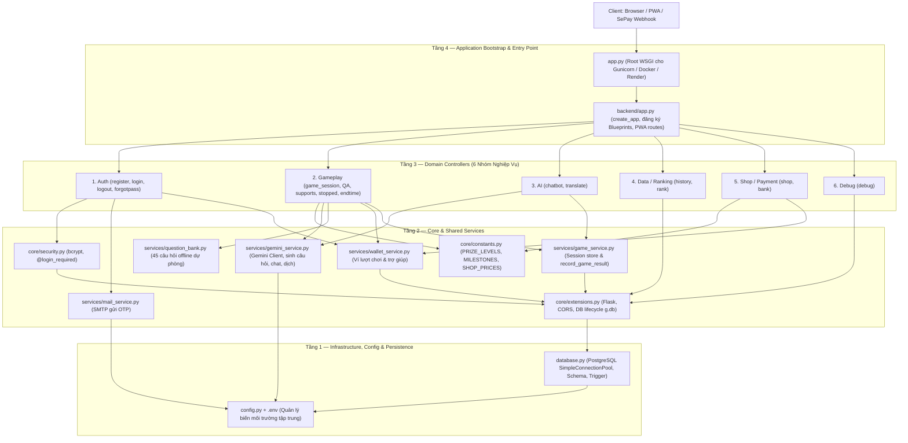

# Kiến Trúc & Tái Cấu Trúc Logic Backend — Dự Án "Ai Là Triệu Phú"

Tài liệu này trình bày phương án **chia lại cấu trúc logic phần Backend** cho dự án **Ai Là Triệu Phú** dựa trên mã nguồn hiện tại (`database.py`, `app.py`, `backend/*.py`).

Mục tiêu của việc tái cấu trúc:
- Áp dụng **Separation of Concerns (Tách biệt trách nhiệm)** theo mô hình **4 Tầng (4-Tier Architecture)** kết hợp **6 nhóm Domain độc lập**.
- Thay thế cơ chế import vòng vòng và "God Module" (`backend/shared.py`) bằng **Flask Blueprints** + **Application Factory (`create_app`)**.
- Loại bỏ toàn bộ mã trùng lặp, file legacy dư thừa và khắc phục các rủi ro kỹ thuật đang tồn tại trong codebase.
- **Đảm bảo tương thích ngược 100% (Zero Breaking Changes)** với toàn bộ URL API đang được Frontend (`static/js/game.js`), PWA và SePay Webhook gọi.

---

## 1. Tổng Quan Kiến Trúc 4 Tầng (4-Tier Layered Architecture)

Toàn bộ phần Backend được tổ chức thành **4 tầng rõ ràng** với luồng phụ thuộc **một chiều từ trên xuống dưới** (tầng trên chỉ gọi tầng dưới, các domain trong Tầng 3 độc lập với nhau):



### Nguyên tắc phụ thuộc (Dependency Rules)
1. **Một chiều (Unidirectional):** `Tầng 4 → Tầng 3 → Tầng 2 → Tầng 1`. Không có tầng dưới nào được `import` ngược lên tầng trên (triệt tiêu hoàn toàn Circular Import).
2. **Độc lập giữa các Domain ở Tầng 3:** Controller này **không import trực tiếp** controller khác (ví dụ: `QA.py`, `stopped.py`, `endtime.py` sẽ không còn `from game_session import record_game_result`, mà cùng gọi `services/game_service.py` ở Tầng 2).
3. **Single Source of Truth:** Mọi cấu hình môi trường, hằng số giải thưởng, Gemini Client, bộ câu hỏi offline và logic DB chỉ được định nghĩa **duy nhất 1 nơi**.

---

## 2. Cấu Trúc Thư Mục Đề Xuất (Before → After)

### 2.1. Thực trạng hiện tại (Cấu trúc phẳng)
Hiện tại thư mục `backend/` chứa 21 file nằm cùng một cấp, tồn tại 3 file legacy chưa xóa (`dbback.py`, `session.py`, `mailforgotpass.py`), một "God Module" `shared.py` ôm quá nhiều trách nhiệm, và nhiều đoạn mã bị nhân bản giữa `shared.py`, `QA.py`, `chatbot.py`, `bank.py`.

### 2.2. Cấu trúc thư mục mới sau khi chia lại logic

```text
millionaire/
├── .env                              # Biến môi trường (KHÔNG commit)
├── app.py                            # [Tầng 4] Root WSGI Entry Point (Gunicorn / Docker / Render)
├── database.py                       # [Tầng 1] PostgreSQL Connection Pool, Schema (8 bảng), Indexes & Trigger
│
└── backend/
    ├── __init__.py
    ├── config.py                     # [Tầng 1] Đọc, chuẩn hóa & kiểm tra biến môi trường (.env)
    ├── app.py                        # [Tầng 4] Application Factory create_app(), đăng ký 6 nhóm Blueprint & PWA
    │
    ├── core/                         # [Tầng 2A] Hạ tầng cốt lõi của ứng dụng
    │   ├── __init__.py
    │   ├── extensions.py             # Quản lý vòng đời DB per-request (get_db, close_db), CORS
    │   ├── security.py               # hash_password, check_password (bcrypt), decorator @login_required
    │   └── constants.py              # PRIZE_LEVELS, MILESTONES, SHOP_PRICES, format_prize, get_safe_prize
    │
    ├── services/                     # [Tầng 2B] Dịch vụ dùng chung & tích hợp bên thứ ba
    │   ├── __init__.py
    │   ├── gemini_service.py         # Khởi tạo duy nhất 1 Gemini Client, sinh 15 câu hỏi, chat MC, dịch câu hỏi
    │   ├── question_bank.py          # Bộ 45 câu hỏi offline (Easy/Medium/Hard) & hàm fallback xáo trộn đáp án
    │   ├── mail_service.py           # Gửi email mã OTP qua SMTP (smtplib)
    │   ├── wallet_service.py         # Nghiệp vụ ví: get_or_create_wallet, cộng/trừ lượt chơi & trợ giúp
    │   └── game_service.py           # Session store quản lý trạng thái ván chơi & hàm record_game_result()
    │
    └── domains/                      # [Tầng 3] Domain Controllers — 6 nhóm nghiệp vụ độc lập
        ├── __init__.py               # Helper register_blueprints(app)
        │
        ├── auth/                     # Nhóm 1: Xác thực & quản lý tài khoản
        │   ├── __init__.py           # Blueprint auth_bp
        │   ├── register.py           # POST /api/auth/register
        │   ├── login.py              # POST /api/auth/login, GET /api/auth/me, GET /, GET /auth
        │   ├── logout.py             # POST /api/auth/logout
        │   └── forgotpass.py         # POST /api/auth/forgot-password, POST /api/auth/verify-reset-code
        │
        ├── gameplay/                 # Nhóm 2: Logic ván chơi cốt lõi
        │   ├── __init__.py           # Blueprint game_bp
        │   ├── game_session.py       # POST /api/game/start
        │   ├── qa.py                 # POST /api/game/answer
        │   ├── supports.py           # POST /api/game/lifeline (50:50, phone, audience)
        │   ├── stopped.py            # POST /api/game/stop
        │   └── endtime.py            # POST /api/game/timeout
        │
        ├── ai/                       # Nhóm 3: Tính năng trí tuệ nhân tạo
        │   ├── __init__.py           # Blueprint ai_bp
        │   ├── chatbot.py            # POST /api/chatbot
        │   └── translate.py          # POST /api/translate
        │
        ├── ranking/                  # Nhóm 4: Dữ liệu lịch sử & bảng xếp hạng
        │   ├── __init__.py           # Blueprint ranking_bp
        │   ├── history.py            # GET /api/game/history
        │   └── rank.py               # GET /api/leaderboard
        │
        ├── shop/                     # Nhóm 5: Cửa hàng & thanh toán tự động
        │   ├── __init__.py           # Blueprint shop_bp
        │   ├── shop.py               # GET /api/shop/wallet, POST /api/shop/create-order,
        │   │                         # GET /api/shop/check-status, GET /api/shop/history
        │   └── bank.py               # POST /api/shop/webhook, POST /api/webhook/sepay
        │
        └── debug/                    # Nhóm 6: Kiểm thử & chẩn đoán hệ thống
            ├── __init__.py           # Blueprint debug_bp (chỉ bật ở dev hoặc có admin key)
            └── debug.py              # GET /api/debug/status, /api/debug/webhooks, /api/debug/transaction/<ref>
```

---

## 3. Chi Tiết Chức Năng Từng Tầng

### Tầng 1 – Infrastructure & Persistence (Cấu hình & Cơ sở dữ liệu)

Đảm nhận kết nối hạ tầng và lưu trữ dữ liệu bền vững, hoàn toàn không phụ thuộc vào Flask.

| Thành phần | Trách nhiệm chính |
|---|---|
| `.env` & `backend/config.py` | Tải biến môi trường một lần duy nhất (`load_dotenv()`), chuẩn hóa giá trị (loại bỏ inline `# comment` bằng `clean_env()`), gom thành class `Config` cho DB, Flask `SECRET_KEY`, `GEMINI_API_KEY`, `SEPAY_*`, `WEBHOOK_SECRET`, `MAIL_*`, `APP_ENV`. |
| `database.py` | Quản lý **PostgreSQL Connection Pool** (`psycopg2.pool.ThreadedConnectionPool` hoặc `SimpleConnectionPool`), cung cấp `init_pool()`, `get_connection()`, `release_connection(conn)`, `create_schema(conn)` và `insert_sample_data(conn)`. |

**Phân quyền sở hữu dữ liệu trên 8 bảng PostgreSQL hiện có:**

| Bảng DB | Tầng / Domain sở hữu chính | Mục đích |
|---|---|---|
| `users` | Auth | Thông tin định danh người dùng (`user_id`, `username`, `email`, `full_name`) |
| `user_passwords` | Auth | Tách riêng `password_hash` (bcrypt) để tăng tính bảo mật |
| `password_reset_codes` | Auth (`forgotpass`) | Lưu mã OTP 6 số có thời hạn 15 phút và cờ `is_used` |
| `user_wallets` | Wallet Service / Shop / Gameplay | Số dư `game_turns` (mặc định 3) và `bonus_lifelines` (mặc định 0) |
| `game_history` | Gameplay / Data-Ranking | Lịch sử từng ván đấu (`result`, `score`, `duration_sec`, `metadata`) |
| `rankings` | Gameplay / Data-Ranking | Tổng hợp điểm, thắng/thua, tự động tính `win_rate` qua trigger `trg_win_rate` |
| `shop_transactions` | Shop / Payment (`shop`, `bank`) | Đơn hàng mua lượt/trợ giúp với `payment_ref` duy nhất (`AMT_<ts>_<hex>`) |
| `webhook_logs` | Shop / Payment (`bank`) & Debug | Lưu vết mọi request webhook (IP, headers, payload, bước xác thực, kết quả) |

---

### Tầng 2 – Core & Shared Services (Tiện ích lõi & Dịch vụ dùng chung)

Tách `backend/shared.py` hiện tại thành hai nhánh gọn gàng để mỗi file chỉ làm đúng một việc:

#### 2A. Core (`backend/core/`)
- **`extensions.py`**:
  - Quản lý vòng đời kết nối DB theo từng HTTP request: `get_db()` lưu vào `flask.g.db`, `close_db()` tự động trả connection về Pool qua `app.teardown_appcontext`.
  - Hỗ trợ helper lấy connection độc lập (`get_standalone_connection()`) cho tác vụ ghi log không phụ thuộc transaction chính (ví dụ ghi `webhook_logs` trong `bank.py`).
- **`security.py`**:
  - `hash_password(pw)` và `check_password(pw, hashed)` dùng `bcrypt`.
  - Decorator `@login_required`: kiểm tra `session['user_id']`, xác minh user còn tồn tại trong DB; trả JSON `401` cho route `/api/*` hoặc `redirect('/auth')` cho route giao diện.
- **`constants.py`**:
  - `PRIZE_LEVELS` (15 mốc từ `200.000 đ` đến `150.000.000 đ`), `MILESTONES = {5: 2_000_000, 10: 22_000_000, 15: 150_000_000}`.
  - `SHOP_PRICES = {'game_turn': 5000, 'bonus_lifeline': 2000}`.
  - `format_prize(amount)` và `get_safe_prize(question_index)`.

#### 2B. Services (`backend/services/`)
- **`gemini_service.py`**:
  - Khởi tạo **duy nhất 1** `gemini_client` (model `models/gemini-flash-latest`) từ `Config.GEMINI_API_KEY`.
  - Cung cấp 3 hàm nghiệp vụ AI dùng chung:
    1. `generate_questions()` — sinh 15 câu hỏi thuần Việt (5 dễ, 5 trung bình, 5 khó) dạng JSON chuẩn.
    2. `generate_mc_reply(player_name, current_question, message)` — đóng vai MC trợ lý (không lộ đáp án, dưới 3 câu).
    3. `translate_question(question_text, answers, target_lang)` — dịch câu hỏi + 4 đáp án sang ngôn ngữ mục tiêu.
- **`question_bank.py`**:
  - Lưu trữ duy nhất 1 bản ngân hàng 45 câu hỏi dự phòng thuần Việt (`LOCAL_EASY_QUESTIONS`, `LOCAL_MEDIUM_QUESTIONS`, `LOCAL_HARD_QUESTIONS`).
  - Hàm `get_local_fallback_questions()`: bốc ngẫu nhiên 5–5–5 câu và xáo trộn vị trí 4 đáp án, cập nhật lại `correct` index.
- **`mail_service.py`**:
  - Hàm `send_email_code(receiver_email, code)` dùng `smtplib` + TLS; tự động chuyển chế độ log console khi chưa cấu hình `MAIL_USERNAME`/`MAIL_PASSWORD`.
- **`wallet_service.py`**:
  - `get_or_create_wallet(cur, user_id)` dùng `INSERT ... ON CONFLICT DO NOTHING` đảm bảo atomic.
  - `deduct_game_turn(cur, user_id)`, `deduct_bonus_lifeline(cur, user_id)`, `credit_wallet(cur, user_id, item_type, quantity)`.
- **`game_service.py`**:
  - Trừu tượng hóa lưu trữ trạng thái ván chơi (`create_session`, `get_session`, `update_session`, `end_session`) để dễ dàng thay thế in-memory `dict` bằng Redis/PostgreSQL khi scale nhiều worker.
  - Hàm `record_game_result(user_id, result, score, duration, metadata=None)` ghi bảng `game_history` và cập nhật bảng `rankings`.

---

### Tầng 3 – Domain Controllers (Nghiệp vụ theo 6 nhóm chức năng)

Chia nhỏ toàn bộ logic ứng dụng thành **6 nhóm độc lập** (Separation of Concerns), mỗi nhóm đóng gói trong một **Flask Blueprint**:

#### 1. Auth (`domains/auth/`: `register`, `login`, `logout`, `forgotpass`)
Đăng ký, xác thực, quản lý phiên và khôi phục mật khẩu.
- **`register.py`**: Validate đầu vào (`username >= 3`, `password >= 6`, đủ `email` & `display_name`), kiểm tra trùng lặp, tạo đồng bộ bản ghi ở 4 bảng (`users`, `user_passwords`, `rankings`, `user_wallets` với 3 lượt miễn phí) trong 1 transaction và tự động thiết lập Flask `session`.
- **`login.py`**:
  - Xác thực tài khoản qua `JOIN users & user_passwords` + `check_password()`, lưu `user_id`, `username`, `display_name` vào `session`.
  - Cung cấp `GET /api/auth/me` để Frontend kiểm tra trạng thái đăng nhập.
  - Render 2 trang giao diện chính: `GET /` (có `@login_required`) và `GET /auth`.
- **`logout.py`**: Xóa các khóa người dùng khỏi `session` (`session.clear()`).
- **`forgotpass.py`**:
  - Bước 1 (`/api/auth/forgot-password`): Kiểm tra email tồn tại, sinh mã OTP 6 chữ số có hạn 15 phút, lưu bảng `password_reset_codes` và gọi `mail_service.send_email_code()`.
  - Bước 2 (`/api/auth/verify-reset-code`): Xác minh OTP mới nhất chưa dùng và còn hạn, băm mật khẩu mới bằng `bcrypt`, cập nhật `user_passwords` và đánh dấu `is_used = TRUE`.

#### 2. Gameplay (`domains/gameplay/`: `game_session`, `qa`, `supports`, `stopped`, `endtime`)
Trái tim của game — quản lý trạng thái ván chơi, kiểm tra đáp án, xử lý quyền trợ giúp, dừng cuộc chơi để bảo toàn mốc thưởng và xử lý hết giờ.
- **`game_session.py`**: Khởi tạo ván chơi mới (`POST /api/game/start`) — kiểm tra và trừ 1 `game_turns` từ `wallet_service`, lấy bộ 15 câu hỏi ưu tiên từ `gemini_service` (tự động fallback sang `question_bank` khi AI lỗi/mất mạng), lưu phiên vào `game_service` và trả câu hỏi 1 (đã ẩn trường `correct`).
- **`qa.py`**: Xử lý chốt đáp án (`POST /api/game/answer`):
  - Nếu **đúng**: tăng `current_question`, cập nhật `prize = PRIZE_LEVELS[current]`. Nếu vượt qua câu 15 → kết thúc thắng (`win`, `150.000.000 đ`) và gọi `record_game_result()`. Ngược lại trả câu hỏi kế tiếp (ẩn `correct`).
  - Nếu **sai**: đóng phiên, tính thưởng theo mốc an toàn `get_safe_prize(current)` (0 đ / 2 triệu / 22 triệu) và ghi kết quả `loss`.
- **`supports.py`**: Xử lý 3 quyền trợ giúp (`POST /api/game/lifeline`):
  - Nếu quyền mặc định trong ván đã dùng → kiểm tra và trừ 1 `bonus_lifelines` trong `user_wallets`.
  - `5050`: loại ngẫu nhiên 2 đáp án sai.
  - `phone`: giả lập gọi người thân (70% gợi ý đúng với độ tự tin 70–95%, 30% sai với độ tự tin 30–60%).
  - `audience`: phân bổ tỷ lệ % khán giả trường quay sao cho tổng bằng 100% và đáp án đúng có trọng số ưu tiên (35–70%).
- **`stopped.py`**: Xử lý người chơi chủ động dừng cuộc chơi (`POST /api/game/stop`) — bảo toàn toàn bộ số tiền thưởng của câu đã trả lời đúng gần nhất (`PRIZE_LEVELS[current - 1]`), đóng phiên và lưu lịch sử.
- **`endtime.py`**: Xử lý hết thời gian 30 giây (`POST /api/game/timeout`) — kết thúc phiên, trả về đáp án đúng, tính tiền theo mốc an toàn `get_safe_prize(current)` và lưu lịch sử.

#### 3. AI (`domains/ai/`: `chatbot`, `translate`)
Gọi `gemini_service` từ Tầng 2 để trả lời trợ lý ảo hoặc dịch nội dung câu hỏi.
- **`chatbot.py`**: Nhận tin nhắn và `session_id` (`POST /api/chatbot`), đọc ngữ cảnh (`player_name`, số câu hiện tại) từ `game_service` rồi gọi `gemini_service.generate_mc_reply()` theo persona MC thân thiện, tuyệt đối không tiết lộ đáp án đúng.
- **`translate.py`**: Nhận `session_id` và `target_lang` (`POST /api/translate`), lấy câu hỏi hiện tại trong phiên chơi và gọi `gemini_service.translate_question()` trả về JSON câu hỏi + 4 phương án đã dịch.

#### 4. Data/Ranking (`domains/ranking/`: `history`, `rank`)
Truy vấn lịch sử các ván đã chơi và tổng hợp bảng xếp hạng.
- **`history.py`**: `GET /api/game/history` (`@login_required`) — truy vấn 20 ván đấu gần nhất của người chơi từ `game_history` sắp xếp theo `played_at DESC`.
- **`rank.py`**: `GET /api/leaderboard` (Public) — `JOIN rankings` với `users`, sắp xếp theo `total_score DESC` trả về Top 10 cao thủ (kèm tổng điểm và số trận thắng).

#### 5. Shop/Payment (`domains/shop/`: `shop`, `bank`)
Mua vật phẩm/quyền trợ giúp và nhận webhook tự động từ SePay VietQR để cộng vật phẩm vào tài khoản.
- **`shop.py`**:
  - `GET /api/shop/wallet` *(chuyển từ `bank.py` về đúng domain `shop.py`)*: trả số dư `game_turns` và `bonus_lifelines`.
  - `POST /api/shop/create-order`: kiểm tra loại vật phẩm (`game_turn`: 5.000đ, `bonus_lifeline`: 2.000đ) và số lượng, tạo `payment_ref` dạng `AMT_<timestamp>_<6-hex>`, lưu đơn `pending` vào `shop_transactions`, trả về ảnh mã QR VietQR (`img.vietqr.io`).
  - `GET /api/shop/check-status?ref=...`: cho Frontend polling trạng thái đơn (`pending` / `paid` / `failed`).
  - `GET /api/shop/history`: trả 20 giao dịch nạp gần nhất của người dùng.
- **`bank.py`**:
  - `POST /api/shop/webhook` và alias `POST /api/webhook/sepay`.
  - Xác thực 3 lớp với `WEBHOOK_SECRET`: (1) HMAC-SHA256 `X-SePay-Signature`, (2) `Authorization: Apikey/Bearer <secret>`, (3) `X-API-Key`/`X-Secret-Key`; kèm hỗ trợ luồng Simulator (HMAC `payment_ref:status`) và gói tin `SEPAYTEST`.
  - Bóc tách mã đơn từ nội dung chuyển khoản bằng Regex `AMT[\s_-]?(\d{10})[\s_-]?([A-Z0-9]{6})` (và fallback định dạng cũ `ML/MT <user_id>`).
  - Kiểm tra **idempotency** (`status == 'paid'` thì bỏ qua), đối chiếu `transferAmount >= total_price`, cập nhật đơn thành `paid` và cộng lượt/trợ giúp vào `user_wallets` trong cùng 1 DB Transaction.
  - Ghi nhật ký mọi yêu cầu vào bảng `webhook_logs` qua kết nối tách biệt để không ảnh hưởng transaction chính.

#### 6. Debug (`domains/debug/`: `debug`)
Các route hỗ trợ kiểm thử nhanh trong quá trình phát triển và vận hành webhook.
- **`debug.py`**:
  - `GET /api/debug/status`: kiểm tra phiên bản ứng dụng, kết nối DB, test Regex bóc mã `AMT_...` và 5 giao dịch mới nhất.
  - `GET /api/debug/webhooks`: xem 20 bản ghi gần nhất từ `webhook_logs`.
  - `GET /api/debug/transaction/<ref>`: tra cứu đồng thời thông tin giao dịch, ví và tài khoản người dùng liên quan.
- **Khuyến nghị bảo mật:** Chỉ đăng ký `debug_bp` khi `ENABLE_DEBUG_ROUTES=true` (môi trường dev), hoặc bắt buộc header `X-Admin-Debug-Key` trên Production.

---

### Tầng 4 – Application Bootstrap & Entry Point (Khởi chạy ứng dụng)

- **`backend/app.py`** (Application Factory):
  - Hàm `create_app()` thực hiện theo trình tự chuẩn:
    1. Tạo đối tượng `Flask(__name__, static_folder='../static', template_folder='../templates')` và nạp `Config`.
    2. Cấu hình `CORS(app, supports_credentials=True)` và đăng ký `teardown_appcontext(close_db)`.
    3. Khởi tạo PostgreSQL Pool và chạy `create_schema()` một lần khi khởi động.
    4. Đăng ký toàn bộ 6 nhóm Blueprints từ `backend/domains/`.
    5. Đăng ký 2 route tĩnh PWA: `GET /manifest.json` và `GET /sw.js`.
- **`app.py` (Root)**:
  - File cầu nối WSGI siêu gọn cho Gunicorn / Docker / Render: import `create_app()` từ `backend.app` và expose biến `app`.

---

## 4. Bản Đồ Chuyển Đổi File (Migration Mapping)

| File hiện tại | Vị trí mới đề xuất | Hành động |
|---|---|---|
| `database.py` | `database.py` | Giữ nguyên vị trí; nâng cấp lên `SimpleConnectionPool` & thêm `release_connection()` |
| `app.py` | `app.py` | Giữ nguyên vai trò WSGI bridge, gọi `create_app()` |
| `backend/app.py` | `backend/app.py` | Refactor thành Application Factory đăng ký Blueprints |
| `backend/shared.py` | `backend/config.py`, `core/*`, `services/*` | Tách nhỏ thành các module đơn nhiệm, xóa "God Module" |
| `backend/register.py`, `login.py`, `logout.py`, `forgotpass.py` | `backend/domains/auth/*.py` | Chuyển decorator `@app.route` → `@auth_bp.route` |
| `backend/game_session.py`, `QA.py`, `supports.py`, `stopped.py`, `endtime.py` | `backend/domains/gameplay/*.py` | Chuyển sang `@game_bp.route`; xóa code sinh câu hỏi lặp trong `QA.py`; tách `record_game_result` sang `services/game_service.py` |
| `backend/chatbot.py`, `translate.py` | `backend/domains/ai/*.py` | Chuyển sang `@ai_bp.route`; dùng chung `gemini_service`; xóa lệnh gọi Gemini lúc import ở `chatbot.py` và hàm rỗng ở `translate.py` |
| `backend/history.py`, `rank.py` | `backend/domains/ranking/*.py` | Chuyển sang `@ranking_bp.route` |
| `backend/shop.py`, `bank.py` | `backend/domains/shop/*.py` | Chuyển sang `@shop_bp.route`; chuyển `/api/shop/wallet` từ `bank.py` về `shop.py`; xóa đoạn đọc env trùng ở `bank.py` |
| `backend/debug.py` | `backend/domains/debug/debug.py` | Chuyển sang `@debug_bp.route`; thêm bảo vệ môi trường |
| `backend/dbback.py` | *(Xóa)* | File legacy đã tích hợp vào `core/extensions.py` & `core/security.py` |
| `backend/session.py` | *(Xóa)* | Bản sao cũ của `game_session.py` (không được import) |
| `backend/mailforgotpass.py` | *(Xóa)* | File legacy đã chuyển thành `services/mail_service.py` |

---

## 5. Bảng Tổng Hợp Toàn Bộ API Endpoints Theo 6 Domain

Toàn bộ đường dẫn URL được giữ nguyên so với phiên bản hiện tại để Frontend (`static/js/game.js`) và SePay hoạt động không cần sửa đổi:

| Nhóm Domain | Method | Endpoint | File Controller Mới | Bảo vệ / Auth | Mô tả |
|---|:---:|---|---|:---:|---|
| **Auth** | `GET` | `/` | `domains/auth/login.py` | `@login_required` | Trang chơi game chính (`index.html`) |
| **Auth** | `GET` | `/auth` | `domains/auth/login.py` | Public | Trang đăng nhập / đăng ký (`signin.html`) |
| **Auth** | `POST` | `/api/auth/register` | `domains/auth/register.py` | Public | Đăng ký tài khoản + tạo ví (3 lượt) & ranking |
| **Auth** | `POST` | `/api/auth/login` | `domains/auth/login.py` | Public | Đăng nhập & lưu Flask session |
| **Auth** | `GET` | `/api/auth/me` | `domains/auth/login.py` | Public | Kiểm tra trạng thái phiên hiện tại |
| **Auth** | `POST` | `/api/auth/logout` | `domains/auth/logout.py` | Session | Đăng xuất & xóa session |
| **Auth** | `POST` | `/api/auth/forgot-password` | `domains/auth/forgotpass.py` | Public | Sinh mã OTP 6 số (15 phút) & gửi email |
| **Auth** | `POST` | `/api/auth/verify-reset-code` | `domains/auth/forgotpass.py` | Public | Xác thực OTP & đặt lại mật khẩu |
| **Gameplay** | `POST` | `/api/game/start` | `domains/gameplay/game_session.py` | `@login_required` | Trừ 1 lượt chơi, sinh 15 câu hỏi (AI/Offline) |
| **Gameplay** | `POST` | `/api/game/answer` | `domains/gameplay/qa.py` | `@login_required` | Chốt đáp án, tính thưởng / mốc an toàn |
| **Gameplay** | `POST` | `/api/game/lifeline` | `domains/gameplay/supports.py` | `@login_required` | Dùng trợ giúp (`5050`, `phone`, `audience`) |
| **Gameplay** | `POST` | `/api/game/stop` | `domains/gameplay/stopped.py` | `@login_required` | Dừng cuộc chơi bảo toàn tiền thưởng |
| **Gameplay** | `POST` | `/api/game/timeout` | `domains/gameplay/endtime.py` | `@login_required` | Xử lý hết 30s suy nghĩ, về mốc an toàn |
| **AI** | `POST` | `/api/chatbot` | `domains/ai/chatbot.py` | Public / Session | Trò chuyện với MC trợ lý ảo Gemini |
| **AI** | `POST` | `/api/translate` | `domains/ai/translate.py` | Public / Session | Dịch câu hỏi hiện tại sang ngôn ngữ khác |
| **Data/Ranking** | `GET` | `/api/game/history` | `domains/ranking/history.py` | `@login_required` | Lấy lịch sử 20 ván đấu gần nhất của user |
| **Data/Ranking** | `GET` | `/api/leaderboard` | `domains/ranking/rank.py` | Public | Lấy Top 10 bảng xếp hạng tổng điểm |
| **Shop/Payment** | `GET` | `/api/shop/wallet` | `domains/shop/shop.py` | `@login_required` | Xem số lượt chơi & trợ giúp hiện có |
| **Shop/Payment** | `POST` | `/api/shop/create-order` | `domains/shop/shop.py` | `@login_required` | Tạo đơn `pending` & sinh mã VietQR |
| **Shop/Payment** | `GET` | `/api/shop/check-status` | `domains/shop/shop.py` | `@login_required` | Polling trạng thái đơn theo `payment_ref` |
| **Shop/Payment** | `GET` | `/api/shop/history` | `domains/shop/shop.py` | `@login_required` | Lấy lịch sử 20 giao dịch nạp gần nhất |
| **Shop/Payment** | `POST` | `/api/shop/webhook` | `domains/shop/bank.py` | SePay Secret | Webhook nhận thanh toán tự động từ SePay |
| **Shop/Payment** | `POST` | `/api/webhook/sepay` | `domains/shop/bank.py` | SePay Secret | Alias cho SePay Webhook |
| **Debug** | `GET` | `/api/debug/status` | `domains/debug/debug.py` | Dev / Admin Key | Kiểm tra phiên bản, kết nối DB & Regex |
| **Debug** | `GET` | `/api/debug/webhooks` | `domains/debug/debug.py` | Dev / Admin Key | Xem 20 log webhook gần nhất |
| **Debug** | `GET` | `/api/debug/transaction/<ref>` | `domains/debug/debug.py` | Dev / Admin Key | Tra cứu chi tiết đơn hàng, ví và user |
| **Bootstrap (PWA)** | `GET` | `/manifest.json` | `backend/app.py` | Public | File cấu hình Progressive Web App |
| **Bootstrap (PWA)** | `GET` | `/sw.js` | `backend/app.py` | Public | Service Worker cho PWA |

---

## 6. Các Vấn Đề Kỹ Thuật Hiện Tại Cần Xử Lý Khi Tái Cấu Trúc

Qua rà soát toàn bộ mã nguồn hiện tại, quá trình tái cấu trúc cần xử lý dứt điểm 7 điểm sau:

1. **Hoàn thiện Connection Pool trong `database.py`**:
   - Hiện `backend/shared.py` đang import `release_connection` từ `database.py`, nhưng `database.py` hiện chỉ giữ 1 biến toàn cục `db_connection` và chưa định nghĩa `release_connection()`. Cần thay bằng `psycopg2.pool.ThreadedConnectionPool` kèm `get_connection()` và `release_connection(conn)` an toàn đa luồng.
2. **Sửa lỗi đóng nhầm DB connection khi ghi `webhook_logs` trong `bank.py`**:
   - Hàm `log_webhook_attempt()` hiện gọi `conn_log = get_db()` (dùng chung `g.db`) rồi gọi `conn_log.close()` ở khối `finally`, dễ làm đứt kết nối ngay trước khi xử lý cộng tiền. Cần dùng một connection riêng từ pool (hoặc trả về pool sau khi `commit`) độc lập với transaction chính.
3. **Loại bỏ mã trùng lặp và side-effect lúc import**:
   - Xóa bản sao `generate_questions_with_ai()` và 45 câu hỏi offline trong `QA.py` (chỉ giữ tại `services/gemini_service.py` và `services/question_bank.py`).
   - Xóa đoạn khởi tạo `genai.Client` + gửi prompt `"Xin chao"` ở đầu file `chatbot.py` (đang tốn 1 lượt gọi API mỗi khi khởi động server).
   - Xóa hàm `clean_env` và 4 biến `SEPAY_*` khai báo lại ở đầu `bank.py`; xóa hàm rỗng `process_chatbot_message()` ở cuối `translate.py`.
4. **Tránh ghi đè (shadow) biến `flask.session`**:
   - Các file `supports.py`, `stopped.py`, `endtime.py`, `chatbot.py`, `translate.py` đang dùng biến cục bộ `session = sessions[session_id]` trùng tên với `flask.session`. Cần đổi thống nhất thành `game_sess` như ở `QA.py`.
5. **Đồng nhất kiểm soát quyền truy cập**:
   - Gắn `@login_required` cho toàn bộ nhóm `Gameplay` (và kiểm tra `game_sess['user_id'] == session['user_id']` để người chơi không thể thao tác lên `session_id` của người khác).
   - Khóa nhóm `Debug` trên môi trường Production (tắt bằng biến môi trường hoặc yêu cầu API key quản trị).
6. **Lưu trữ `sessions` khi chạy đa worker trên Production**:
   - `Dockerfile` đang chạy Gunicorn với `--workers 3 --threads 2`. Nếu giữ `sessions = {}` trên RAM, các request liên tiếp của cùng 1 ván chơi rơi vào các worker khác nhau sẽ báo `404 Phiên chơi không tồn tại`. Tầng `services/game_service.py` nên thiết kế interface sẵn để chuyển sang **Redis** hoặc bảng PostgreSQL `active_game_sessions` (hoặc cấu hình 1 worker với `--threads` khi chưa dùng Redis).
7. **Đồng bộ cổng (Port) giữa Flask, Dockerfile và Docker Compose**:
   - `Dockerfile` và `ngrok` dùng port `5001`, trong khi `docker-compose.yml` map `5002:5002` và `backend/app.py` dùng `5002`. Nên đọc thống nhất từ biến môi trường `PORT` (mặc định `5002`) trên toàn hệ thống.

---

## 7. Lộ Trình Thực Hiện Tái Cấu Trúc (5 Bước An Toàn)

1. **Bước 1 — Dọn dẹp & Chuẩn hóa Tầng 1:** Xóa 3 file legacy (`dbback.py`, `session.py`, `mailforgotpass.py`), hoàn thiện Connection Pool trong `database.py`, tạo `backend/config.py`.
2. **Bước 2 — Tách Tầng 2 (`core/` & `services/`):** Tách `shared.py` ra `core/` (`extensions`, `security`, `constants`) và `services/` (`gemini_service`, `question_bank`, `mail_service`, `wallet_service`, `game_service`).
3. **Bước 3 — Chuyển đổi Tầng 3 sang 6 Blueprints:** Lần lượt chuyển 6 nhóm (`auth`, `gameplay`, `ai`, `ranking`, `shop`, `debug`) vào `backend/domains/`, giữ nguyên toàn bộ URL endpoints và sửa các bug kỹ thuật ở Mục 6.
4. **Bước 4 — Cập nhật Tầng 4 (`create_app`):** Viết Application Factory trong `backend/app.py`, đăng ký 6 Blueprints và cập nhật cầu nối WSGI `app.py`.
5. **Bước 5 — Kiểm thử hồi quy (Regression Testing):** Chạy kiểm tra cú pháp (`py_compile`), test toàn bộ 28 routes (Auth → Start Game → Answer/Lifeline/Stop/Timeout → Chatbot/Translate → History/Rank → Shop/Webhook SePay) để xác nhận tương thích hoàn toàn với Frontend.
