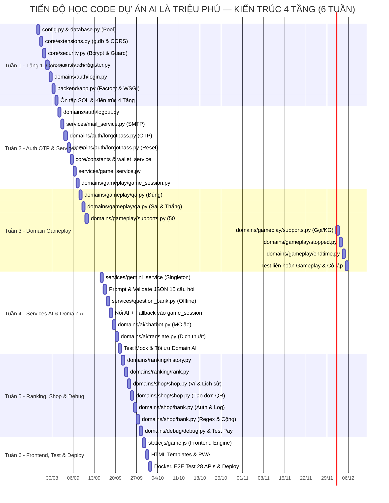

# 📅 Kế Hoạch Học Code Backend & Toàn Bộ Hệ Thống — Dự Án "Ai Là Triệu Phú"

> **Thời gian:** 25/08/2026 → 30/09/2026 (6 tuần, 38 buổi)  
> **Mục tiêu:** Hiểu sâu bản chất từng dòng code, nắm vững tư duy kiến trúc 4 tầng kết hợp 6 Domain Blueprints độc lập (theo [BACKEND_ARCHITECTURE.md](BACKEND_ARCHITECTURE.md)) và tự code lại toàn bộ dự án từ đầu  
> **Công nghệ:** Python 3.11+ (Flask Blueprints & Application Factory), PostgreSQL (`ThreadedConnectionPool`), Google Gemini AI (`google-genai`), SePay VietQR Webhook, Docker, Vanilla JS & CSS

---

## 🏗️ Kiến trúc hệ thống 4 tầng (4-Tier Modular Architecture)

Toàn bộ Backend được phân tách theo **luồng phụ thuộc một chiều** (`Tầng 4 → Tầng 3 → Tầng 2 → Tầng 1`), tuyệt đối **không có Circular Import** và **không có import chéo giữa các Domain trong Tầng 3**:

```text
┌───────────────────────────────────────────────────────────────────────────┐
│  TẦNG 4: APPLICATION BOOTSTRAP & ENTRY POINT                              │
│  • app.py                — Root WSGI Entry Point (Gunicorn / Docker)      │
│  • backend/app.py        — Application Factory create_app(), đăng ký      │
│                            6 Blueprints & PWA routes (/manifest.json,     │
│                            /sw.js)                                        │
└────────────────────────────────────┬──────────────────────────────────────┘
                                     │
┌────────────────────────────────────▼──────────────────────────────────────┐
│  TẦNG 3: DOMAIN CONTROLLERS — 6 NHÓM BLUEPRINTS ĐỘC LẬP (backend/domains/)│
│  • backend/domains/__init__.py (register_blueprints)                      │
│  1. Auth         (auth_bp)    : register.py, login.py, logout.py,         │
│                                 forgotpass.py                             │
│  2. Gameplay     (game_bp)    : game_session.py, qa.py, supports.py,      │
│                                 stopped.py, endtime.py                    │
│  3. AI           (ai_bp)      : chatbot.py, translate.py                  │
│  4. Data/Ranking (ranking_bp) : history.py, rank.py                       │
│  5. Shop/Payment (shop_bp)    : shop.py, bank.py                          │
│  6. Debug        (debug_bp)   : debug.py                                  │
└────────────────────────────────────┬──────────────────────────────────────┘
                                     │
┌────────────────────────────────────▼──────────────────────────────────────┐
│  TẦNG 2: CORE & SHARED SERVICES (Tách nhỏ từ shared.py cũ)                │
│  • 2A. Core (backend/core/):                                              │
│    - extensions.py : Vòng đời DB per-request (g.db, close_db),            │
│                      standalone_db_connection(), CORS                     │
│    - security.py   : Mã hóa bcrypt, @login_required,                      │
│                      @debug_access_required                               │
│    - constants.py  : PRIZE_LEVELS, MILESTONES, SHOP_PRICES, Regex SePay,  │
│                      format_prize(), get_safe_prize()                     │
│  • 2B. Services (backend/services/):                                      │
│    - gemini_service.py : Lazy Singleton Gemini Client (sinh câu hỏi,      │
│                          MC chatbot, dịch thuật)                          │
│    - question_bank.py  : Ngân hàng 45 câu hỏi offline & hàm fallback      │
│    - mail_service.py   : Gửi mã OTP khôi phục mật khẩu qua SMTP           │
│    - wallet_service.py : Quản lý ví lượt chơi & trợ giúp (atomic)         │
│    - game_service.py   : GameSessionStore & record_game_result()          │
└────────────────────────────────────┬──────────────────────────────────────┘
                                     │
┌────────────────────────────────────▼──────────────────────────────────────┐
│  TẦNG 1: INFRASTRUCTURE, CONFIG & PERSISTENCE                             │
│  • .env & backend/config.py : Tập trung & chuẩn hóa biến môi trường       │
│  • database.py              : ThreadedConnectionPool, release_connection, │
│                               Schema 8 bảng, Indexes & Trigger win_rate   │
└───────────────────────────────────────────────────────────────────────────┘
```

---

## 📖 Chi Tiết Lộ Trình 6 Tuần (38 Buổi)

### 🔹 Tuần 1 (25/08 → 31/08): Tầng 1 (Config & DB Pool), Tầng 2A (Core) & Domain Auth Cơ bản

> **Mục tiêu:** Dựng nền tảng Tầng 1, Tầng 2A, Tầng 4 (Application Factory + Blueprints) và hoàn thành luồng Đăng ký + Đăng nhập chuẩn bảo mật bcrypt.

| Buổi | Nội dung chi tiết | File liên quan | Kết quả đạt được |
|:---:|:---|:---|:---|
| **1** | **Setup môi trường, Config & Database Pool (Tầng 1):**<br>• Cấu hình `.env` và viết [backend/config.py](backend/config.py): lớp `Config`, hàm `clean_env()` xử lý inline comment.<br>• Viết [database.py](database.py): dùng `psycopg2.pool.ThreadedConnectionPool`, viết `init_pool()`, `get_connection()`, `release_connection()` (tự rollback nếu transaction lỗi) và `create_schema()` khởi tạo 8 bảng + Indexes + Trigger `trg_win_rate`. | `.env`<br>[backend/config.py](backend/config.py)<br>[database.py](database.py) | Chạy `python database.py` → Khởi tạo Pool & Schema 8 bảng thành công trong PostgreSQL |
| **2** | **Core Extensions & Vòng đời Kết nối DB (Tầng 2A):**<br>• Viết [backend/core/extensions.py](backend/core/extensions.py): quản lý kết nối per-request `get_db()` trên `flask.g` và `close_db()` gắn vào `teardown_appcontext`.<br>• Viết context manager `standalone_db_connection()` cấp kết nối tách biệt cho ghi log độc lập (tránh đóng nhầm `g.db`).<br>• Viết `init_extensions(app)` cấu hình CORS và `init_db_schema(app)`. | [backend/core/extensions.py](backend/core/extensions.py) | Kết nối DB tự động cấp và trả về Pool sạch sẽ sau mỗi request, không leak connection |
| **3** | **Core Security: Bcrypt & Custom Decorators (Tầng 2A):**<br>• Viết [backend/core/security.py](backend/core/security.py): `hash_password()`, `check_password()` dùng `bcrypt`.<br>• Viết `@login_required` (kiểm tra session + xác minh `user_id` còn tồn tại trong DB; trả `401 JSON` cho `/api/*`, redirect `/auth` cho trang HTML).<br>• Viết `@debug_access_required` bảo vệ route chẩn đoán theo môi trường & `X-Admin-Debug-Key`. | [backend/core/security.py](backend/core/security.py) | Mã hóa & kiểm tra mật khẩu chuẩn xác; `@login_required` chặn truy cập chưa đăng nhập |
| **4** | **Domain 1 (Auth) — Blueprint & Đăng ký tài khoản:**<br>• Tạo `auth_bp = Blueprint("auth", __name__)` trong [backend/domains/auth/\_\_init\_\_.py](backend/domains/auth/__init__.py).<br>• Viết [backend/domains/auth/register.py](backend/domains/auth/register.py) (`POST /api/auth/register`): validate `username >= 3`, `password >= 6`, chống trùng lặp, khởi tạo đồng bộ `users`, `user_passwords`, `rankings`, `user_wallets` (3 lượt miễn phí) trong 1 transaction. | [backend/domains/auth/\_\_init\_\_.py](backend/domains/auth/__init__.py)<br>[backend/domains/auth/register.py](backend/domains/auth/register.py) | Gửi request đăng ký → Trả `{ "success": true }`, tạo đủ 4 bảng & tự đăng nhập vào session |
| **5** | **Domain 1 (Auth) — Đăng nhập, Session & Giao diện:**<br>• Viết [backend/domains/auth/login.py](backend/domains/auth/login.py) với 4 route: `POST /api/auth/login` (`JOIN users & user_passwords`), `GET /api/auth/me`, `GET /` (`@login_required`), `GET /auth`.<br>• Quản lý cookie phiên an toàn với `session['user_id']`, `session['username']`, `session['display_name']`. | [backend/domains/auth/login.py](backend/domains/auth/login.py) | Đăng nhập thành công, `/api/auth/me` trả `logged_in: true`, vào được trang chủ `/` |
| **6** | **Tầng 4 — Application Factory (`create_app`) & WSGI Bridge:**<br>• Viết [backend/domains/\_\_init\_\_.py](backend/domains/__init__.py) (`register_blueprints(app)`).<br>• Viết [backend/app.py](backend/app.py) theo mẫu **Application Factory** `create_app()` nạp `Config`, gắn extensions, đăng ký Blueprints, khởi tạo schema & tuyến PWA.<br>• Viết cầu nối WSGI siêu gọn tại [app.py](app.py). | [backend/domains/\_\_init\_\_.py](backend/domains/__init__.py)<br>[backend/app.py](backend/app.py)<br>[app.py](app.py) | Chạy mượt cả 2 cách: `python app.py` (root) và `cd backend && python app.py` trên port 5002 |
| **7** | **Ôn tập Kiến trúc 4 Tầng, SQL & Đánh giá Tuần 1:**<br>• Review `SELECT`, `INSERT`, `JOIN`, `ON CONFLICT`, ràng buộc khóa ngoại `ON DELETE CASCADE`.<br>• So sánh tư duy **Application Factory + Blueprints** so với cấu trúc phẳng `shared.py` cũ (triệt tiêu Circular Import). | Toàn bộ file Tuần 1 | Nắm vững ranh giới giữa Tầng 1, Tầng 2A, Tầng 3 và Tầng 4; luồng Auth chạy ổn định |

---

### 🔹 Tuần 2 (01/09 → 07/09): Hoàn thiện Auth, Tầng 2B (Mail, Wallet, Game Service) & Mở Phiên Chơi

> **Mục tiêu:** Hoàn thiện Đăng xuất, Quên mật khẩu qua OTP Email, xây dựng tầng Services dùng chung (`mail`, `wallet`, `game`) và tạo phiên chơi game đầu tiên.

| Buổi | Nội dung chi tiết | File liên quan | Kết quả đạt được |
|:---:|:---|:---|:---|
| **8** | **Domain 1 (Auth) — Đăng xuất (`logout.py`):**<br>• Viết [backend/domains/auth/logout.py](backend/domains/auth/logout.py) (`POST /api/auth/logout`).<br>• Xóa sạch khóa phiên người dùng (`user_id`, `username`, `display_name`) và hiểu vòng đời Session Cookie. | [backend/domains/auth/logout.py](backend/domains/auth/logout.py) | Gọi logout → Hủy phiên, `/api/auth/me` trả về `logged_in: false` |
| **9** | **Tầng 2B — Service Gửi Email SMTP (`mail_service.py`):**<br>• Viết [backend/services/mail_service.py](backend/services/mail_service.py) đọc cấu hình SMTP từ `Config`.<br>• Viết `send_email_code(receiver_email, code)` dùng `smtplib.SMTP` + `starttls()`, tự động chuyển chế độ mô phỏng console log khi chạy dev chưa có mật khẩu ứng dụng. | [backend/services/mail_service.py](backend/services/mail_service.py)<br>[backend/config.py](backend/config.py) | Test gửi OTP thành công qua SMTP thật hoặc in rõ mã 6 số ra terminal |
| **10** | **Domain 1 (Auth) — Quên mật khẩu Bước 1 (Gửi OTP):**<br>• Viết `POST /api/auth/forgot-password` trong [backend/domains/auth/forgotpass.py](backend/domains/auth/forgotpass.py).<br>• Kiểm tra email tồn tại, sinh mã 6 chữ số (`random.randint(100000, 999999)`), lưu bảng `password_reset_codes` với hạn 15 phút và gọi `mail_service.send_email_code()`. | [backend/domains/auth/forgotpass.py](backend/domains/auth/forgotpass.py) | Gửi email hợp lệ → Tạo bản ghi OTP trong DB và gửi mã xác nhận |
| **11** | **Domain 1 (Auth) — Quên mật khẩu Bước 2 (Xác thực & Đổi MK):**<br>• Viết `POST /api/auth/verify-reset-code`: validate mật khẩu mới ≥ 6 ký tự, kiểm tra OTP mới nhất (`is_used = FALSE AND expires_at > NOW()`).<br>• Hash mật khẩu mới bằng `bcrypt`, cập nhật `user_passwords` (`password_hash`, `last_changed = NOW()`) và đánh dấu `is_used = TRUE`. | [backend/domains/auth/forgotpass.py](backend/domains/auth/forgotpass.py) | Đổi mật khẩu thành công, OTP cũ không dùng lại được, đăng nhập bằng mật khẩu mới OK |
| **12** | **Tầng 2A & 2B — Constants & Wallet Service:**<br>• Viết [backend/core/constants.py](backend/core/constants.py): `PRIZE_LEVELS` (15 mốc), `MILESTONES` (`5`, `10`, `15`), `SHOP_PRICES`, Regex SePay (`AMT_REF_PATTERN`, `LEGACY_REF_PATTERN`), `format_prize()`, `get_safe_prize()`.<br>• Viết [backend/services/wallet_service.py](backend/services/wallet_service.py): `get_or_create_wallet()` (`ON CONFLICT DO NOTHING`), `deduct_game_turn()`, `deduct_bonus_lifeline()`, `credit_wallet()` (dùng `SAVEPOINT` bảo vệ transaction chính). | [backend/core/constants.py](backend/core/constants.py)<br>[backend/services/wallet_service.py](backend/services/wallet_service.py) | Tập trung toàn bộ hằng số game/shop và nghiệp vụ ví atomic ở Tầng 2 |
| **13** | **Tầng 2B — Game Service (Session Store & Lưu Kết Quả):**<br>• Viết [backend/services/game_service.py](backend/services/game_service.py): lớp `GameSessionStore` (`create_session`, `get_session`, `delete_session`) tách riêng để sẵn sàng nâng cấp lên Redis.<br>• Viết `record_game_result()` ghi `game_history` & cập nhật `rankings` (kích hoạt trigger `trg_win_rate`).<br>• Hiểu lý do đặt ở Tầng 2: tránh để `qa.py`, `stopped.py`, `endtime.py` import chéo vào `game_session.py`. | [backend/services/game_service.py](backend/services/game_service.py) | Phiên chơi được quản lý tập trung; kết thúc ván tự động lưu lịch sử và cập nhật xếp hạng |
| **14** | **Domain 2 (Gameplay) — Khởi tạo ván chơi (`game_session.py`):**<br>• Tạo `game_bp = Blueprint("gameplay", __name__)` trong [backend/domains/gameplay/\_\_init\_\_.py](backend/domains/gameplay/__init__.py).<br>• Viết [backend/domains/gameplay/game_session.py](backend/domains/gameplay/game_session.py) (`POST /api/game/start` với `@login_required`): gọi `deduct_game_turn()`, lấy 15 câu hỏi, lưu vào `session_store` và xóa trường `correct` trước khi trả về Frontend. | [backend/domains/gameplay/\_\_init\_\_.py](backend/domains/gameplay/__init__.py)<br>[backend/domains/gameplay/game_session.py](backend/domains/gameplay/game_session.py) | Bắt đầu ván → Ví trừ 1 lượt, trả `session_id` và câu hỏi 1 (không lộ đáp án) |

---

### 🔹 Tuần 3 (08/09 → 14/09): Hoàn thiện Domain 2 — Gameplay (QA, Trợ giúp, Dừng chơi, Hết giờ)

> **Mục tiêu:** Xây dựng trọn vẹn luật chơi "Ai Là Triệu Phú" với kiểm soát quyền sở hữu phiên chơi, chống shadow biến `flask.session` và xử lý đủ 4 kịch bản kết thúc ván.

| Buổi | Nội dung chi tiết | File liên quan | Kết quả đạt được |
|:---:|:---|:---|:---|
| **15** | **Xử lý Trả lời Đúng (`qa.py`):**<br>• Viết [backend/domains/gameplay/qa.py](backend/domains/gameplay/qa.py) (`POST /api/game/answer` với `@login_required`).<br>• Đặt tên biến `game_sess` (tránh ghi đè `flask.session`), kiểm tra tồn tại (`404`), quyền sở hữu `user_id` (`403`) và trạng thái `is_active` (`400`).<br>• Trường hợp **ĐÚNG**: tăng `current_question`, cập nhật thưởng, trả câu tiếp theo (đã ẩn `correct`). | [backend/domains/gameplay/qa.py](backend/domains/gameplay/qa.py) | Chọn đúng đáp án → Chuyển sang câu kế tiếp kèm tiền thưởng hiện tại |
| **16** | **Xử lý Trả lời Sai, Mốc An Toàn & Chiến Thắng Câu 15 (`qa.py`):**<br>• Nhánh **SAI**: đóng phiên, tính mốc an toàn `get_safe_prize(current)` (0đ / 2tr / 22tr), gọi `record_game_result(..., 'loss', ...)`.<br>• Nhánh **THẮNG CÂU 15**: đóng phiên, ghi `'win'` với giải tối đa `150.000.000 đ`. | [backend/domains/gameplay/qa.py](backend/domains/gameplay/qa.py) | Sai tụt đúng mốc an toàn; đúng câu 15 nhận cúp triệu phú; không trả lời lại phiên đã đóng |
| **17** | **Quyền trợ giúp 50:50 & Bonus Lifelines (`supports.py`):**<br>• Viết [backend/domains/gameplay/supports.py](backend/domains/gameplay/supports.py) (`POST /api/game/lifeline` với `@login_required`).<br>• Validate `type` hợp lệ (`5050`, `phone`, `audience`) trước khi chạm vào ví.<br>• Xử lý `5050` loại 2 đáp án sai; nếu đã dùng quyền mặc định trong ván → tự gọi `wallet_service.deduct_bonus_lifeline()`. | [backend/domains/gameplay/supports.py](backend/domains/gameplay/supports.py) | Dùng `5050` loại đúng 2 đáp án sai; dùng lần 2 trừ `bonus_lifelines` trong ví |
| **18** | **Quyền trợ giúp Gọi điện thoại & Khán giả (`supports.py`):**<br>• Hoàn thiện `phone`: giả lập người thân gợi ý (70% đúng với độ tự tin 70–95%, 30% sai với 30–60%).<br>• Hoàn thiện `audience`: sinh phân bố 4 đáp án tổng đúng 100%, đáp án đúng có trọng số cao (35–70%). | [backend/domains/gameplay/supports.py](backend/domains/gameplay/supports.py) | Trả lời tư vấn Gọi điện & biểu đồ % Khán giả trường quay hợp lý |
| **19** | **Dừng cuộc chơi bảo toàn tiền thưởng (`stopped.py`):**<br>• Viết [backend/domains/gameplay/stopped.py](backend/domains/gameplay/stopped.py) (`POST /api/game/stop` với `@login_required`).<br>• Kiểm tra sở hữu phiên & `is_active` (chống bấm dừng lặp), tính `PRIZE_LEVELS[current - 1]` và ghi kết quả kèm metadata `{"reason": "stopped"}`. | [backend/domains/gameplay/stopped.py](backend/domains/gameplay/stopped.py) | Dừng cuộc chơi → Nhận trọn số tiền câu đã trả lời đúng gần nhất |
| **20** | **Xử lý Hết thời gian 30 giây (`endtime.py`):**<br>• Viết [backend/domains/gameplay/endtime.py](backend/domains/gameplay/endtime.py) (`POST /api/game/timeout` với `@login_required`).<br>• Đóng phiên, trả về `correct_answer` và tiền thưởng theo mốc an toàn `get_safe_prize()`, ghi kết quả kèm metadata `{"reason": "timeout"}`. | [backend/domains/gameplay/endtime.py](backend/domains/gameplay/endtime.py) | Hết 30s → Server kết thúc phiên và trả đúng đáp án + mốc thưởng an toàn |
| **21** | **Kiểm thử liên hoàn Domain Gameplay & Cô lập phiên:**<br>• Test đủ 4 kịch bản: sai câu 6 (2tr), dừng câu 3 (600k), hết giờ câu 10 (22tr), thắng câu 15 (150tr).<br>• Test user thứ 2 gửi `session_id` của user 1 → server chặn `403 Forbidden`. | Toàn bộ file Tuần 3 | Toàn bộ Gameplay chạy trơn tru, dữ liệu `game_history` & `rankings` chính xác 100% |

---

### 🔹 Tuần 4 (15/09 → 21/09): Tầng 2B (AI & Question Bank) & Domain 3 — AI (Chatbot & Dịch thuật)

> **Mục tiêu:** Tập trung toàn bộ logic gọi Google Gemini AI vào `services/gemini_service.py` theo chuẩn Lazy Singleton, tách ngân hàng 45 câu hỏi offline vào `services/question_bank.py`, và xây dựng Domain AI (`chatbot`, `translate`).

| Buổi | Nội dung chi tiết | File liên quan | Kết quả đạt được |
|:---:|:---|:---|:---|
| **22** | **Tầng 2B — Khởi tạo Gemini Service (Lazy Singleton):**<br>• Viết [backend/services/gemini_service.py](backend/services/gemini_service.py): dùng SDK `google-genai`, khởi tạo duy nhất 1 `gemini_client` khi thực sự cần (`get_gemini_client()`), **không gọi API test lúc import** để tránh tốn quota và làm chậm khởi động server. | [backend/services/gemini_service.py](backend/services/gemini_service.py)<br>[backend/config.py](backend/config.py) | 1 Gemini Client dùng chung toàn hệ thống, khởi động server tức thì |
| **23** | **Prompt Engineering & Validate JSON sinh 15 câu hỏi:**<br>• Viết `generate_questions_with_ai()` trong [backend/services/gemini_service.py](backend/services/gemini_service.py).<br>• Soạn prompt yêu cầu 15 câu thuần Việt (5 `easy`, 5 `medium`, 5 `hard`), trích xuất mảng JSON `[...]` và viết `_is_valid_question_list()` kiểm tra chặt từng câu (có `question`, đúng 4 `answers`, `correct` ∈ `0..3`). | [backend/services/gemini_service.py](backend/services/gemini_service.py) | Gọi hàm sinh ra 15 câu hỏi JSON hợp lệ, tự loại bỏ phản hồi lỗi định dạng |
| **24** | **Tầng 2B — Ngân hàng câu hỏi Offline Fallback:**<br>• Viết [backend/services/question_bank.py](backend/services/question_bank.py): nguồn duy nhất chứa 45 câu hỏi (`LOCAL_EASY_QUESTIONS`, `LOCAL_MEDIUM_QUESTIONS`, `LOCAL_HARD_QUESTIONS`) — không lặp lại ở bất kỳ controller nào.<br>• Viết `get_local_fallback_questions()`: bốc 5–5–5 câu và xáo trộn vị trí 4 đáp án + cập nhật lại chỉ số `correct`. | [backend/services/question_bank.py](backend/services/question_bank.py) | Luôn trả về 15 câu hỏi mới mẻ, đáp án xáo trộn kể cả khi mất mạng |
| **25** | **Kết nối nguồn câu hỏi AI + Fallback vào Gameplay:**<br>• Tích hợp `generate_questions_with_ai()` và `get_local_fallback_questions()` trong [backend/domains/gameplay/game_session.py](backend/domains/gameplay/game_session.py).<br>• Đảm bảo ván chơi luôn khởi tạo thành công 100% dù Gemini API lỗi hoặc hết quota. | [backend/domains/gameplay/game_session.py](backend/domains/gameplay/game_session.py) | Ưu tiên câu hỏi AI, tự động chuyển sang offline mượt mà khi có sự cố |
| **26** | **Domain 3 (AI) — Chatbot MC Trợ Lý (`chatbot.py`):**<br>• Tạo `ai_bp = Blueprint("ai", __name__)` trong [backend/domains/ai/\_\_init\_\_.py](backend/domains/ai/__init__.py).<br>• Viết `generate_mc_reply()` trong `gemini_service.py` (Persona MC hóm hỉnh, cấm lộ đáp án, < 3 câu) và route `POST /api/chatbot` trong [backend/domains/ai/chatbot.py](backend/domains/ai/chatbot.py) đọc ngữ cảnh từ `session_store`. | [backend/domains/ai/\_\_init\_\_.py](backend/domains/ai/__init__.py)<br>[backend/domains/ai/chatbot.py](backend/domains/ai/chatbot.py) | Trò chuyện với MC đúng ngữ cảnh câu đang chơi và không bị lộ đáp án |
| **27** | **Domain 3 (AI) — Dịch thuật câu hỏi (`translate.py`):**<br>• Viết `translate_question_with_ai()` trong `gemini_service.py` (bóc bỏ markdown fence ```` ```json ````, kiểm tra đủ khóa `question` & `answers`).<br>• Viết route `POST /api/translate` trong [backend/domains/ai/translate.py](backend/domains/ai/translate.py). | [backend/domains/ai/translate.py](backend/domains/ai/translate.py) | Dịch câu hỏi hiện tại và 4 phương án sang Tiếng Anh / ngôn ngữ bất kỳ chuẩn JSON |
| **28** | **Kiểm thử & Tối ưu Domain AI:**<br>• Dùng `unittest.mock.patch` kiểm thử nhanh `chatbot` & `translate` không tốn quota.<br>• Kiểm tra trường hợp thiếu `GEMINI_API_KEY`, `session_id` không tồn tại (`404`) và tối ưu prompt. | Toàn bộ file Tuần 4 | Toàn bộ tính năng AI ổn định, phản hồi nhanh, fallback an toàn |

---

### 🔹 Tuần 5 (22/09 → 28/09): Domain 4 (Data/Ranking), Domain 5 (Shop/Payment) & Domain 6 (Debug)

> **Mục tiêu:** Xây dựng thống kê Lịch sử & Bảng xếp hạng, hoàn thiện Cửa hàng VietQR + SePay Webhook tự động (có idempotency & log độc lập) và nhóm Debug có phân quyền môi trường.

| Buổi | Nội dung chi tiết | File liên quan | Kết quả đạt được |
|:---:|:---|:---|:---|
| **29** | **Domain 4 (Data/Ranking) — Lịch sử đấu (`history.py`):**<br>• Tạo `ranking_bp = Blueprint("ranking", __name__)` trong [backend/domains/ranking/\_\_init\_\_.py](backend/domains/ranking/__init__.py).<br>• Viết [backend/domains/ranking/history.py](backend/domains/ranking/history.py) (`GET /api/game/history`, `@login_required`): truy vấn 20 ván gần nhất từ `game_history` theo `played_at DESC`. | [backend/domains/ranking/\_\_init\_\_.py](backend/domains/ranking/__init__.py)<br>[backend/domains/ranking/history.py](backend/domains/ranking/history.py) | Trả về danh sách 20 ván đấu gần nhất của đúng user đang đăng nhập |
| **30** | **Domain 4 (Data/Ranking) — Bảng xếp hạng (`rank.py`):**<br>• Viết [backend/domains/ranking/rank.py](backend/domains/ranking/rank.py) (`GET /api/leaderboard`, Public): `JOIN rankings & users` sắp xếp theo `total_score DESC LIMIT 10`. | [backend/domains/ranking/rank.py](backend/domains/ranking/rank.py) | Trả về Top 10 cao thủ gồm tên hiển thị, tổng điểm và số trận thắng |
| **31** | **Domain 5 (Shop/Payment) — Ví, Kiểm tra đơn & Lịch sử nạp:**<br>• Tạo `shop_bp = Blueprint("shop", __name__)` trong [backend/domains/shop/\_\_init\_\_.py](backend/domains/shop/__init__.py).<br>• Viết `GET /api/shop/wallet` (đưa về đúng domain `shop.py`), `GET /api/shop/check-status` (lọc kèm `user_id` chống tra cứu chéo đơn) và `GET /api/shop/history` trong [backend/domains/shop/shop.py](backend/domains/shop/shop.py). | [backend/domains/shop/\_\_init\_\_.py](backend/domains/shop/__init__.py)<br>[backend/domains/shop/shop.py](backend/domains/shop/shop.py) | Xem số dư ví, polling trạng thái đơn và lịch sử 20 giao dịch nạp gần nhất |
| **32** | **Domain 5 (Shop/Payment) — Tạo đơn hàng & Sinh VietQR:**<br>• Viết `POST /api/shop/create-order` trong [backend/domains/shop/shop.py](backend/domains/shop/shop.py): validate `item_type` & `quantity` (chặn cả kiểu `bool` & số ≤ 0), sinh mã `AMT_<timestamp>_<6-hex>`, lưu đơn `pending` vào `shop_transactions` và trả về URL QR `img.vietqr.io`. | [backend/domains/shop/shop.py](backend/domains/shop/shop.py)<br>[backend/core/constants.py](backend/core/constants.py) | Nhận được ảnh QR VietQR kèm đúng số tiền và nội dung chuyển khoản |
| **33** | **Domain 5 (Shop/Payment) — Xác thực SePay Webhook & Log Độc Lập:**<br>• Viết [backend/domains/shop/bank.py](backend/domains/shop/bank.py) với 2 route `POST /api/shop/webhook` và alias `POST /api/webhook/sepay`.<br>• Xây dựng xác thực 3 lớp header (`X-SePay-Signature` HMAC-SHA256, `Authorization: Apikey/Bearer`, `X-API-Key/X-Secret-Key`), xử lý `SEPAYTEST` & Simulator HMAC.<br>• Viết `_log_webhook_attempt()` dùng `standalone_db_connection()` ghi vào `webhook_logs` tách khỏi `g.db`. | [backend/domains/shop/bank.py](backend/domains/shop/bank.py)<br>[backend/core/extensions.py](backend/core/extensions.py) | Chặn request giả mạo (`401`/`403`), ghi log webhook an toàn không làm đứt transaction chính |
| **34** | **Domain 5 (Shop/Payment) — Đối soát Regex, Idempotency & Cộng lượt:**<br>• Dùng `AMT_REF_PATTERN` & `LEGACY_REF_PATTERN` (từ `core/constants.py`) trích mã đơn dù ngân hàng bỏ dấu `_`.<br>• Kiểm tra **idempotency** (`status == 'paid'` thì bỏ qua, chống cộng đúp), kiểm tra `transferAmount >= total_price`, cập nhật đơn thành `paid` và gọi `wallet_service.credit_wallet()` trong 1 transaction. | [backend/domains/shop/bank.py](backend/domains/shop/bank.py)<br>[backend/services/wallet_service.py](backend/services/wallet_service.py) | Gửi webhook hợp lệ → Đơn chuyển `paid`, ví cộng đúng lượt; gửi lặp không bị cộng 2 lần |
| **35** | **Domain 6 (Debug) — Chẩn đoán hệ thống & Khóa Production:**<br>• Tạo `debug_bp = Blueprint("debug", __name__)` trong [backend/domains/debug/\_\_init\_\_.py](backend/domains/debug/__init__.py).<br>• Viết [backend/domains/debug/debug.py](backend/domains/debug/debug.py): `GET /api/debug/status`, `GET /api/debug/webhooks`, `GET /api/debug/transaction/<ref>` gắn `@debug_access_required` (mở ở dev, yêu cầu `X-Admin-Debug-Key` trên production). | [backend/domains/debug/\_\_init\_\_.py](backend/domains/debug/__init__.py)<br>[backend/domains/debug/debug.py](backend/domains/debug/debug.py) | Theo dõi trực tiếp trạng thái DB, Regex, Webhook logs & khóa an toàn trên Production |

---

### 🔹 Tuần 6 (29/09 → 30/09): Frontend Engine, Docker hóa, Regression Test & Triển khai Production

> **Mục tiêu:** Nắm vững tầng Frontend kết nối với 6 nhóm Domain Blueprints, đóng gói Docker chuẩn port `5002`, chạy kiểm thử hồi quy toàn bộ 28 endpoints và triển khai Production.

| Buổi | Nội dung chi tiết | File liên quan | Kết quả đạt được |
|:---:|:---|:---|:---|
| **36** | **Mổ xẻ Frontend Game Engine:**<br>• Đọc hiểu [static/js/game.js](static/js/game.js): quản lý state ván chơi, đồng hồ 30 giây, hiệu ứng âm thanh Web Audio API.<br>• Đối chiếu từng hàm `fetch()` (`startGame`, `selectAnswer`, `useLifeline`, `stopGame`, `timeUp`, `sendChat`, `translateQuestion`) với đúng hợp đồng JSON của 6 Domain Blueprints. | [static/js/game.js](static/js/game.js) | Nắm vững 100% luồng đồng bộ trạng thái giữa Frontend và Backend |
| **37** | **Giao diện HTML Templates & PWA:**<br>• Phân tích [templates/signin.html](templates/signin.html), [templates/index.html](templates/index.html), [templates/shop.html](templates/shop.html) (bao gồm cơ chế polling `/api/shop/check-status` mỗi 4 giây).<br>• Tìm hiểu cấu hình Progressive Web App (`static/manifest.json`, `static/sw.js`) được phục vụ từ Tầng 4 [backend/app.py](backend/app.py). | [templates/](templates/)<br>[backend/app.py](backend/app.py) | Hiểu cơ chế render template kết hợp REST API và cài đặt app PWA |
| **38** | **Docker, Gunicorn, Kiểm thử hồi quy 28 Endpoints & Deploy:**<br>• Phân tích [Dockerfile](Dockerfile) (multi-stage, `gunicorn --bind 0.0.0.0:5002 --workers 1 --threads 4`), [docker-compose.yml](docker-compose.yml) (PostgreSQL 16 + Web + Ngrok), [docker-entrypoint.sh](docker-entrypoint.sh).<br>• Chạy kiểm thử hồi quy tự động toàn bộ **28 endpoints** trên PostgreSQL thực, xác minh **0 cross-domain imports** và hoàn tất triển khai. | [Dockerfile](Dockerfile)<br>[docker-compose.yml](docker-compose.yml)<br>[docker-entrypoint.sh](docker-entrypoint.sh)<br>[app.py](app.py)<br>[BACKEND_ARCHITECTURE.md](BACKEND_ARCHITECTURE.md) | Hệ thống chạy ổn định bằng cả Python local lẫn Docker/Render, pass 100% test 28 endpoints |

---

## 📊 Bảng Tra Cứu Toàn Bộ 28 API Endpoints (Theo 6 Domain & Bootstrap)

| # | Nhóm Domain | Method | Endpoint | File Controller | Quyền / Auth | Chức năng chính |
|:---:|---|:---:|---|---|:---:|---|
| 1 | **Auth** | `GET` | `/` | [domains/auth/login.py](backend/domains/auth/login.py) | `@login_required` | Trang chơi game chính (`index.html`) |
| 2 | **Auth** | `GET` | `/auth` | [domains/auth/login.py](backend/domains/auth/login.py) | Public | Trang đăng nhập / đăng ký (`signin.html`) |
| 3 | **Auth** | `POST` | `/api/auth/register` | [domains/auth/register.py](backend/domains/auth/register.py) | Public | Đăng ký tài khoản, bcrypt, tạo ví (3 lượt) & ranking |
| 4 | **Auth** | `POST` | `/api/auth/login` | [domains/auth/login.py](backend/domains/auth/login.py) | Public | Đăng nhập & thiết lập session cookie |
| 5 | **Auth** | `GET` | `/api/auth/me` | [domains/auth/login.py](backend/domains/auth/login.py) | Public | Kiểm tra thông tin phiên đăng nhập hiện tại |
| 6 | **Auth** | `POST` | `/api/auth/logout` | [domains/auth/logout.py](backend/domains/auth/logout.py) | Session | Đăng xuất, xóa thông tin phiên |
| 7 | **Auth** | `POST` | `/api/auth/forgot-password` | [domains/auth/forgotpass.py](backend/domains/auth/forgotpass.py) | Public | Sinh mã OTP 6 số (15 phút) & gửi Email |
| 8 | **Auth** | `POST` | `/api/auth/verify-reset-code` | [domains/auth/forgotpass.py](backend/domains/auth/forgotpass.py) | Public | Xác thực OTP và đặt lại mật khẩu mới |
| 9 | **Gameplay** | `POST` | `/api/game/start` | [domains/gameplay/game_session.py](backend/domains/gameplay/game_session.py) | `@login_required` | Trừ 1 lượt ví, sinh 15 câu hỏi (AI/Offline) |
| 10 | **Gameplay** | `POST` | `/api/game/answer` | [domains/gameplay/qa.py](backend/domains/gameplay/qa.py) | `@login_required` | Chốt đáp án, tính thưởng / mốc an toàn |
| 11 | **Gameplay** | `POST` | `/api/game/lifeline` | [domains/gameplay/supports.py](backend/domains/gameplay/supports.py) | `@login_required` | Dùng 50:50, Gọi điện, Khán giả (+ bonus ví) |
| 12 | **Gameplay** | `POST` | `/api/game/stop` | [domains/gameplay/stopped.py](backend/domains/gameplay/stopped.py) | `@login_required` | Dừng cuộc chơi bảo toàn tiền thưởng |
| 13 | **Gameplay** | `POST` | `/api/game/timeout` | [domains/gameplay/endtime.py](backend/domains/gameplay/endtime.py) | `@login_required` | Xử lý hết 30s suy nghĩ, về mốc an toàn |
| 14 | **AI** | `POST` | `/api/chatbot` | [domains/ai/chatbot.py](backend/domains/ai/chatbot.py) | Public / Session | Trò chuyện với MC Trợ lý ảo Gemini |
| 15 | **AI** | `POST` | `/api/translate` | [domains/ai/translate.py](backend/domains/ai/translate.py) | Public / Session | Dịch câu hỏi & 4 đáp án bằng Gemini AI |
| 16 | **Data/Ranking** | `GET` | `/api/game/history` | [domains/ranking/history.py](backend/domains/ranking/history.py) | `@login_required` | Xem lịch sử 20 ván chơi gần nhất |
| 17 | **Data/Ranking** | `GET` | `/api/leaderboard` | [domains/ranking/rank.py](backend/domains/ranking/rank.py) | Public | Bảng xếp hạng Top 10 cao thủ điểm cao |
| 18 | **Shop/Payment** | `GET` | `/api/shop/wallet` | [domains/shop/shop.py](backend/domains/shop/shop.py) | `@login_required` | Xem số dư lượt chơi & trợ giúp dự phòng |
| 19 | **Shop/Payment** | `POST` | `/api/shop/create-order` | [domains/shop/shop.py](backend/domains/shop/shop.py) | `@login_required` | Tạo đơn `pending` và sinh mã VietQR |
| 20 | **Shop/Payment** | `GET` | `/api/shop/check-status` | [domains/shop/shop.py](backend/domains/shop/shop.py) | `@login_required` | Polling trạng thái đơn theo `payment_ref` |
| 21 | **Shop/Payment** | `GET` | `/api/shop/history` | [domains/shop/shop.py](backend/domains/shop/shop.py) | `@login_required` | Lịch sử 20 giao dịch mua hàng gần nhất |
| 22 | **Shop/Payment** | `POST` | `/api/shop/webhook` | [domains/shop/bank.py](backend/domains/shop/bank.py) | SePay Secret | Webhook nhận thanh toán tự động từ SePay |
| 23 | **Shop/Payment** | `POST` | `/api/webhook/sepay` | [domains/shop/bank.py](backend/domains/shop/bank.py) | SePay Secret | Alias endpoint cho SePay Webhook |
| 24 | **Debug** | `GET` | `/api/debug/status` | [domains/debug/debug.py](backend/domains/debug/debug.py) | `@debug_access_required` | Kiểm tra phiên bản, kết nối DB & Regex |
| 25 | **Debug** | `GET` | `/api/debug/webhooks` | [domains/debug/debug.py](backend/domains/debug/debug.py) | `@debug_access_required` | Xem 20 bản ghi nhật ký `webhook_logs` |
| 26 | **Debug** | `GET` | `/api/debug/transaction/<ref>` | [domains/debug/debug.py](backend/domains/debug/debug.py) | `@debug_access_required` | Tra cứu chi tiết đơn hàng, ví và user |
| 27 | **Bootstrap (PWA)** | `GET` | `/manifest.json` | [backend/app.py](backend/app.py) | Public | File cấu hình Progressive Web App |
| 28 | **Bootstrap (PWA)** | `GET` | `/sw.js` | [backend/app.py](backend/app.py) | Public | Service Worker cho PWA |

---

## 📈 Sơ Đồ Tiến Độ (Gantt Chart)



---

## 📌 Checklist Kỹ Năng & Kiến Thức Thu Đạt

- [ ] **Kiến trúc Phần mềm (Architecture):** Thiết kế mô hình **4 Tầng** kết hợp **6 Domain Blueprints độc lập** (Separation of Concerns), nguyên tắc phụ thuộc một chiều, triệt tiêu Circular Import & God Module.
- [ ] **Python Core:** Context Manager (`@contextmanager`), Decorator nâng cao (`@login_required`, `@debug_access_required`), Lazy Singleton, quản lý cấu hình tập trung (`backend/config.py`).
- [ ] **Flask Framework:** Mẫu **Application Factory (`create_app`)**, **Flask Blueprints**, Request Context `g`, vòng đời `teardown_appcontext`, Session Cookie an toàn.
- [ ] **PostgreSQL & Database Design:** `ThreadedConnectionPool`, `release_connection` chống leak/aborted transaction, `standalone_db_connection()` cho tác vụ ghi log độc lập, `SAVEPOINT`, `ON CONFLICT`, Trigger `trg_win_rate`.
- [ ] **Bảo mật Web & Thanh toán:** Băm mật khẩu `bcrypt`, cô lập quyền sở hữu `session_id` / đơn hàng theo `user_id`, xác thực Webhook 3 lớp (`HMAC-SHA256`, `Authorization`, `API Key`), xử lý **Idempotency** chống cộng tiền đúp và khóa Debug routes trên Production.
- [ ] **Google Gemini AI:** Kỹ thuật Prompt Engineering + kiểm định cấu trúc JSON đầu ra (`_is_valid_question_list`), Persona & Constraint Prompting (MC không lộ đáp án), chiến lược Offline Fallback 100%.
- [ ] **Kiểm thử & DevOps:** Viết bộ kiểm thử hồi quy End-to-End cho đủ 28 API endpoints, đóng gói Multi-stage Docker & Docker Compose, cấu hình Gunicorn WSGI (`port 5002`) và triển khai Production.
