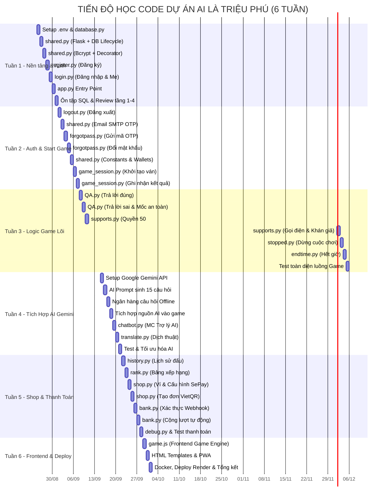

# 📅 Kế Hoạch Học Code Backend & Toàn Bộ Hệ Thống — Dự Án "Ai Là Triệu Phú"

> **Thời gian:** 25/08/2026 → 30/09/2026 (6 tuần, 38 buổi)  
> **Mục tiêu:** Hiểu sâu bản chất từng dòng code, nắm vững tư duy kiến trúc và tự code lại toàn bộ dự án từ đầu  
> **Công nghệ:** Python 3.10+ (Flask), PostgreSQL (psycopg2 Connection Pool), Google Gemini AI, SePay VietQR, Docker, Vanilla JS & CSS  

---

## 🏗️ Kiến trúc hệ thống 4 tầng (4-Tier Architecture)

```
┌─────────────────────────────────────────────────────────────────┐
│  TẦNG 1: CẤU HÌNH & DATABASE (Infrastructure & Persistence)     │
│  • .env (Biến môi trường)                                       │
│  • database.py (Connection Pool, Khởi tạo Schema, Triggers)     │
└───────────────────────────────┬─────────────────────────────────┘
                                │
┌───────────────────────────────▼─────────────────────────────────┐
│  TẦNG 2: MODULE TRUNG TÂM & TIỆN ÍCH DÙNG CHUNG (Core & Shared) │
│  • backend/shared.py                                            │
│    - Khởi tạo Flask App, CORS, Secret Key                       │
│    - Quản lý Database Context (`g.db`, `teardown_appcontext`)   │
│    - Mã hóa bcrypt & Decorator `@login_required`                │
│    - Cấu hình Email SMTP & Gemini AI Client                     │
│    - Ngân hàng câu hỏi Offline & Tiền thưởng / Mốc an toàn     │
└───────────────────────────────┬─────────────────────────────────┘
                                │
┌───────────────────────────────▼─────────────────────────────────┐
│  TẦNG 3: CÁC FILE CHỨC NĂNG THEO DOMAIN (Route Controllers)     │
│  • Xác thực: register.py, login.py, logout.py, forgotpass.py    │
│  • Ván chơi: game_session.py, QA.py, supports.py, stopped.py,   │
│              endtime.py                                         │
│  • AI & Dịch thuật: chatbot.py, translate.py                    │
│  • Dữ liệu & Xếp hạng: history.py, rank.py                      │
│  • Thanh toán & Cửa hàng: shop.py, bank.py                      │
│  • Hệ thống & Debug: debug.py                                   │
└───────────────────────────────┬─────────────────────────────────┘
                                │
┌───────────────────────────────▼─────────────────────────────────┐
│  TẦNG 4: ENTRY POINT & KHỞI CHẠY (Application Bootstrap)        │
│  • backend/app.py (Import toàn bộ routes, PWA router, Dev run)  │
│  • app.py (Root WSGI entry point phục vụ Gunicorn / Render)     │
└─────────────────────────────────────────────────────────────────┘
```

---

## 📖 Chi Tiết Lộ Trình 6 Tuần (38 Buổi)

### 🔹 Tuần 1 (25/08 → 31/08): Nền tảng, Database & Xác thực Cơ bản

> **Mục tiêu:** Dựng xong 4 tầng kiến trúc cơ bản, hoàn thành luồng Đăng ký + Đăng nhập với cơ chế bảo mật mật khẩu bcrypt.

| Buổi | Nội dung chi tiết | File liên quan | Kết quả đạt được |
|:---:|:---|:---|:---|
| **1** | **Setup môi trường & Database Pool:**<br>• Cấu hình [.env](.env) (Database URL, Secret Keys).<br>• Viết [database.py](database.py): Sử dụng `psycopg2.pool.SimpleConnectionPool`, viết hàm `get_connection()`, `release_connection()`.<br>• Viết hàm `create_schema()` khởi tạo các bảng: `users`, `user_passwords`, `rankings`, `user_wallets`. | [.env](.env)<br>[database.py](database.py) | Chạy `python database.py` → In ra `✅ Tạo schema thành công!` và kiểm tra bảng trong PostgreSQL |
| **2** | **Core Flask & Quản lý kết nối Database:**<br>• Khởi tạo Flask app, cấu hình CORS, Secret Key.<br>• Viết cơ chế quản lý vòng đời DB per-request: `get_db()` và `close_db(e)` gắn vào `g` object và `teardown_appcontext`.<br>• Hiểu rõ lý do dùng pattern này (tránh leak connection và không phải mở/đóng thủ công ở từng route). | [backend/shared.py](backend/shared.py) | Khởi chạy Flask app thử nghiệm, gọi `get_db()` trả về connection sạch sẽ |
| **3** | **Bảo mật mật khẩu & Decorator Auth:**<br>• Viết `hash_password()` và `check_password()` dùng thư viện `bcrypt`.<br>• Viết Custom Decorator `@login_required` để bảo vệ các private endpoint.<br>• Đào sâu kỹ thuật xử lý ngoại lệ `try/except` và cách cấu trúc `if/else` gọn gàng. | [backend/shared.py](backend/shared.py) | Chạy test mã hóa chuỗi password thành công, `@login_required` chặn request khi chưa đăng nhập |
| **4** | **API Đăng ký tài khoản:**<br>• Viết [backend/register.py](backend/register.py) với route `POST /api/auth/register`.<br>• Kiểm tra hợp lệ dữ liệu (username, email, password).<br>• Xử lý ngoại lệ bắt lỗi trùng lặp `IntegrityError` từ DB.<br>• Tự động khởi tạo bản ghi trong `user_wallets` và `rankings`. | [backend/register.py](backend/register.py) | Gửi request qua Postman/Curl → Trả về `{ "success": true }` và dữ liệu được lưu vào DB |
| **5** | **API Đăng nhập & Quản lý Session:**<br>• Viết [backend/login.py](backend/login.py) với các route: `POST /api/auth/login`, `GET /api/auth/me`, `GET /`, `GET /auth`.<br>• Lưu `user_id` và `username` vào Flask `session`.<br>• Route `/api/auth/me` trả về thông tin trạng thái đăng nhập hiện tại. | [backend/login.py](backend/login.py) | Đăng nhập thành công, session được lưu cookie, gọi `/api/auth/me` trả về `logged_in: true` |
| **6** | **Entry Point & Ghép nối Tầng 4:**<br>• Viết [backend/app.py](backend/app.py): Import các blueprint/routes từ `register`, `login`.<br>• Gọi `create_schema()` khi ứng dụng khởi động.<br>• Chạy server cục bộ và kiểm tra toàn bộ luồng Auth từ Đăng ký → Đăng nhập → Kiểm tra me. | [backend/app.py](backend/app.py)<br>[app.py](app.py) | Server chạy ổn định trên port 5000, luồng Auth hoạt động trơn tru |
| **7** | **Ôn tập SQL & Đánh giá tuần 1:**<br>• Review các câu lệnh SQL đã dùng (`SELECT`, `INSERT`, `JOIN`, ràng buộc khóa ngoại `FOREIGN KEY`).<br>• Đặt breakpoint / debug các lỗi thường gặp.<br>• Hệ thống hóa kiến trúc 4 tầng trên sơ đồ. | Toàn bộ file Tuần 1 | Nắm vững cú pháp SQL cơ bản, phân biệt rõ vai trò của từng tầng |

---

### 🔹 Tuần 2 (01/09 → 07/09): Hoàn thiện Auth & Khởi tạo Phiên Chơi

> **Mục tiêu:** Hoàn thiện tính năng Đăng xuất, Quên mật khẩu qua Email OTP, hiểu cơ chế Ví lượt chơi và khởi tạo phiên chơi game.

| Buổi | Nội dung chi tiết | File liên quan | Kết quả đạt được |
|:---:|:---|:---|:---|
| **8** | **Đăng xuất (Logout):**<br>• Viết [backend/logout.py](backend/logout.py) với route `POST /api/auth/logout`.<br>• Xóa sạch session với `session.clear()`.<br>• Hiểu rõ vòng đời của Session Cookie trên trình duyệt. | [backend/logout.py](backend/logout.py) | Gọi logout → Session bị hủy, `/api/auth/me` trả về `logged_in: false` |
| **9** | **Cấu hình Email SMTP & Gửi OTP:**<br>• Bổ sung cấu hình SMTP trong `shared.py` (`MAIL_SERVER`, `MAIL_PORT`, `MAIL_USERNAME`, `MAIL_PASSWORD`).<br>• Viết hàm `send_email_code(email, code)` sử dụng thư viện chuẩn `smtplib` và `email.mime.text.MIMEText`. | [backend/shared.py](backend/shared.py) | Test hàm gửi mail → Nhận được mã OTP 6 số qua email thật hoặc in ra console log |
| **10** | **Quên mật khẩu - Bước 1 (Gửi mã OTP):**<br>• Viết route `POST /api/auth/forgot-password` trong [backend/forgotpass.py](backend/forgotpass.py).<br>• Sinh mã ngẫu nhiên 6 chữ số (`random.randint(100000, 999999)`).<br>• Lưu mã vào bảng `password_reset_codes` kèm thời hạn hết hạn 15 phút (`datetime.now() + timedelta(minutes=15)`). | [backend/forgotpass.py](backend/forgotpass.py) | Gọi API với email hợp lệ → Sinh bản ghi OTP trong DB và gửi email mã xác nhận |
| **11** | **Quên mật khẩu - Bước 2 (Xác thực & Đổi mật khẩu):**<br>• Viết route `POST /api/auth/verify-reset-code`.<br>• Kiểm tra mã khớp + còn hạn (`expires_at > NOW()`).<br>• Hash mật khẩu mới bằng `bcrypt` và cập nhật bảng `user_passwords`.<br>• Đánh dấu mã đã dùng hoặc xóa mã. | [backend/forgotpass.py](backend/forgotpass.py) | Đổi mật khẩu thành công và dùng mật khẩu mới đăng nhập lại bình thường |
| **12** | **Bộ hằng số Game & Quản lý Ví Lượt chơi:**<br>• Định nghĩa bảng tiền thưởng `PRIZE_LEVELS` (15 mốc: từ 200k đến 150 triệu VNĐ).<br>• Định nghĩa các mốc an toàn `MILESTONES = {5: 2000000, 10: 22000000, 15: 150000000}`.<br>• Viết hàm `get_or_create_wallet(user_id)` xử lý `INSERT ... ON CONFLICT DO NOTHING`. | [backend/shared.py](backend/shared.py) | Hiểu cấu trúc dữ liệu lưu trữ tiến trình game và ví của user |
| **13** | **Khởi tạo ván chơi (`start_game`):**<br>• Viết route `POST /api/game/start` trong [backend/game_session.py](backend/game_session.py).<br>• Kiểm tra số lượt chơi trong ví → Trừ 1 lượt chơi.<br>• Tạo `session_id` ngẫu nhiên (UUID4).<br>• Chuẩn bị bộ 15 câu hỏi (tạm thời lấy từ bộ ngân hàng offline), lưu phiên vào biến bộ nhớ `sessions[session_id]`. | [backend/game_session.py](backend/game_session.py) | Gọi start game → Ví bị trừ 1 lượt, trả về `session_id` và dữ liệu câu hỏi số 1 |
| **14** | **Ghi nhận kết quả ván đấu (`record_game_result`):**<br>• Viết hàm `record_game_result(user_id, score, prize_money, is_winner, stop_type)`.<br>• Ghi nhận ván đấu vào bảng `game_history`.<br>• Cập nhật thống kê trong bảng `rankings` (`total_score`, `highest_score`, `total_games`, `total_wins`, `total_losses`). | [backend/game_session.py](backend/game_session.py) | Kết thúc ván đấu → Bảng lịch sử và bảng xếp hạng tự động cập nhật đúng |

---

### 🔹 Tuần 3 (08/09 → 14/09): Logic Game Chính (QA, Trợ giúp, Dừng chơi, Hết giờ)

> **Mục tiêu:** Xây dựng trọn vẹn toàn bộ quy tắc trò chơi — Trả lời trắc nghiệm, 3 quyền trợ giúp, chủ động dừng cuộc chơi, xử lý hết thời gian (timeout).

| Buổi | Nội dung chi tiết | File liên quan | Kết quả đạt được |
|:---:|:---|:---|:---|
| **15** | **Xử lý Trả lời Đúng:**<br>• Viết [backend/QA.py](backend/QA.py) với route `POST /api/game/answer`.<br>• Kiểm tra `answer_index` người chơi gửi lên so với đáp án đúng trong `sessions[session_id]`.<br>• Trường hợp **ĐÚNG**: Tăng `current_question`, cập nhật tiền thưởng tạm tính, trả về nội dung câu hỏi tiếp theo. | [backend/QA.py](backend/QA.py) | Chọn đúng đáp án → Nhận tiếp câu hỏi số 2 kèm thông báo chính xác |
| **16** | **Xử lý Trả lời Sai & Chiến thắng Câu 15:**<br>• Trường hợp **SAI**: Tính toán mốc thưởng an toàn đạt được (0đ, 2 triệu, hoặc 22 triệu), gọi `record_game_result()`, xóa session.<br>• Trường hợp **THẮNG CÂU 15**: Trả về trạng thái triệu phú (`is_winner: true`), ghi nhận giải thưởng tối đa 150 triệu. | [backend/QA.py](backend/QA.py) | Trả lời sai rớt về đúng mốc an toàn; trả lời đúng câu 15 nhận cúp chiến thắng |
| **17** | **Quyền trợ giúp 50:50:**<br>• Viết [backend/supports.py](backend/supports.py) với route `POST /api/game/lifeline`.<br>• Xử lý loại `50:50`: Giữ lại đáp án đúng và chọn ngẫu nhiên 1 trong 3 đáp án sai bằng `random.choice()`, loại bỏ 2 đáp án sai còn lại.<br>• Đánh dấu quyền trợ giúp `fifty_fifty = true` để không dùng lại được. | [backend/supports.py](backend/supports.py) | Gọi 50:50 → Trả về danh sách 2 đáp án bị ẩn, không thể gọi lại lần 2 |
| **18** | **Quyền trợ giúp Gọi điện thoại & Hỏi ý kiến khán giả:**<br>• Xử lý loại `phone`: Giả lập chuyên gia / AI đưa ra nhận định gợi ý đáp án.<br>• Xử lý loại `audience`: Sinh tỷ lệ phần trăm phân bổ cho 4 đáp án A, B, C, D (đáp án đúng có trọng số cao hơn). | [backend/supports.py](backend/supports.py) | Gọi điện → Nhận lời tư vấn; Khán giả → Nhận biểu đồ % bình chọn hợp lý |
| **19** | **Dừng cuộc chơi bảo toàn tiền thưởng:**<br>• Viết [backend/stopped.py](backend/stopped.py) với route `POST /api/game/stop`.<br>• Người chơi chủ động dừng cuộc chơi → Nhận trọn vẹn số tiền thưởng của câu hỏi đúng gần nhất.<br>• Gọi `record_game_result()`, giải phóng session. | [backend/stopped.py](backend/stopped.py) | Bấm dừng cuộc chơi → Nhận đúng số tiền đã kiếm được mà không bị tụt về mốc an toàn |
| **20** | **Xử lý Hết thời gian suy nghĩ (Timeout):**<br>• Viết [backend/endtime.py](backend/endtime.py) với route `POST /api/game/timeout`.<br>• Khi hết 30 giây mà chưa đưa ra câu trả lời → Tính thua cuộc theo mốc an toàn tương tự như trả lời sai. | [backend/endtime.py](backend/endtime.py) | Hết 30s → Server xử lý kết thúc game và trả về tiền thưởng an toàn |
| **21** | **Tổng kiểm tra & Test liên hoàn Logic Game:**<br>• Thực hiện toàn bộ flow chơi 1 ván game mẫu qua Postman/Curl: `Start` → `Answer Đúng 5 câu` → `Dùng 50:50` → `Dùng Khán giả` → `Dừng cuộc chơi`.<br>• Kiểm tra tính toàn vẹn dữ liệu trong cơ sở dữ liệu. | Toàn bộ file Tuần 3 | Ván chơi chạy mượt mà từ đầu đến cuối không phát sinh ngoại lệ |

---

### 🔹 Tuần 4 (15/09 → 21/09): Tích hợp AI (Google Gemini), Chatbot MC & Dịch thuật

> **Mục tiêu:** Tích hợp SDK Google Gemini để tự động sinh câu hỏi đa dạng theo chuẩn format, xây dựng Chatbot MC hỗ trợ và tính năng dịch câu hỏi đa ngôn ngữ.

| Buổi | Nội dung chi tiết | File liên quan | Kết quả đạt được |
|:---:|:---|:---|:---|
| **22** | **Cài đặt & Kết nối Google Gemini API:**<br>• Cài đặt thư viện `google-genai` hoặc `google-generativeai`.<br>• Khởi tạo client kết nối với `GEMINI_API_KEY`.<br>• Viết script test gửi prompt đơn giản và đọc phản hồi từ AI. | [backend/shared.py](backend/shared.py) | Kết nối Gemini thành công, test prompt nhận phản hồi nhanh chóng |
| **23** | **Prompt Engineering sinh 15 câu hỏi tự động:**<br>• Viết hàm `generate_questions_with_ai()` trong `shared.py`.<br>• Soạn thảo System Prompt chi tiết: Yêu cầu AI tạo đúng 15 câu (5 Dễ, 5 Trung bình, 5 Khó) với định dạng JSON chuẩn `[{"question", "options", "correct_index"}]`.<br>• Viết cơ chế làm sạch chuỗi Markdown json bọc ngoài trước khi `json.loads()`. | [backend/shared.py](backend/shared.py) | Gọi hàm `generate_questions_with_ai()` → Trả về mảng 15 câu hỏi JSON chuẩn xác |
| **24** | **Ngân hàng câu hỏi Offline (Fallback Strategy):**<br>• Xây dựng bộ ngân hàng câu hỏi dự phòng: `LOCAL_EASY_QUESTIONS`, `LOCAL_MEDIUM_QUESTIONS`, `LOCAL_HARD_QUESTIONS`.<br>• Viết hàm `get_local_fallback_questions()`: Dùng `random.sample()` chọn ngẫu nhiên và xáo trộn vị trí đáp án để mỗi lần chơi là một trải nghiệm mới. | [backend/shared.py](backend/shared.py) | Hàm offline trả về 15 câu hỏi hoàn chỉnh kể cả khi ngắt kết nối mạng hoặc lỗi AI |
| **25** | **Tích hợp nguồn AI vào luồng Khởi tạo Game:**<br>• Cập nhật `game_session.py`: Ưu tiên gọi Gemini AI trước, nếu timeout/lỗi thì tự động fallback về câu hỏi Offline không làm gián đoạn người dùng. | [backend/game_session.py](backend/game_session.py) | Ván chơi luôn được khởi tạo thành công 100% dù có lỗi mạng hay không |
| **26** | **Chatbot MC Lại Văn Sâm / Phan Đăng AI:**<br>• Viết [backend/chatbot.py](backend/chatbot.py) với route `POST /api/chatbot`.<br>• Thiết lập Persona MC: Hóm hỉnh, khích lệ người chơi, tuyệt đối không tiết lộ trực tiếp đáp án đúng.<br>• Giới hạn độ dài câu trả lời dưới 3 câu ngắn gọn. | [backend/chatbot.py](backend/chatbot.py) | Gửi tin nhắn trò chuyện → Nhận phản hồi vui nhộn đúng phong thái MC |
| **27** | **API Dịch thuật câu hỏi đa ngôn ngữ:**<br>• Viết [backend/translate.py](backend/translate.py) với route `POST /api/translate`.<br>• Sử dụng Gemini AI để dịch câu hỏi và 4 phương án sang ngôn ngữ yêu cầu (tiếng Anh, v.v.). | [backend/translate.py](backend/translate.py) | Gọi dịch câu hỏi → Trả về bản dịch chuẩn nghĩa |
| **28** | **Đánh giá & Tối ưu hóa tính năng AI:**<br>• Đo lường thời gian phản hồi của Gemini API.<br>• Tinh chỉnh prompt để hạn chế tối đa ảo giác (hallucination).<br>• Test kiểm thử các trường hợp AI trả về format lạ. | Toàn bộ file Tuần 4 | Toàn bộ tính năng AI ổn định, độ trễ chấp nhận được, có fallback an toàn |

---

### 🔹 Tuần 5 (22/09 → 28/09): Cửa hàng, Webhook Ngân hàng (SePay), Lịch sử & Xếp hạng

> **Mục tiêu:** Xây dựng tính năng Ví lượt chơi, Cửa hàng VietQR SePay tự động cộng lượt khi nhận tiền chuyển khoản, và các API thống kê bảng xếp hạng.

| Buổi | Nội dung chi tiết | File liên quan | Kết quả đạt được |
|:---:|:---|:---|:---|
| **29** | **API Lịch sử đấu (Game History):**<br>• Viết [backend/history.py](backend/history.py) với route `GET /api/game/history`.<br>• Truy vấn bảng `game_history` theo `user_id`, sắp xếp `ORDER BY played_at DESC LIMIT 20`. | [backend/history.py](backend/history.py) | Trả về danh sách các ván đấu đã chơi gồm điểm, tiền thưởng, kết quả |
| **30** | **API Bảng xếp hạng (Leaderboard):**<br>• Viết [backend/rank.py](backend/rank.py) với route `GET /api/leaderboard`.<br>• Thực hiện `JOIN` giữa bảng `rankings` và `users`, sắp xếp theo `total_score DESC` lấy Top 20 cao thủ. | [backend/rank.py](backend/rank.py) | Trả về bảng xếp hạng người chơi có tổng điểm cao nhất |
| **31** | **API Ví người dùng & Cấu hình SePay:**<br>• Viết route `GET /api/shop/wallet` trong [backend/shop.py](backend/shop.py).<br>• Đọc cấu hình SePay từ `shared.py` (`SEPAY_BANK_CODE`, `SEPAY_ACCOUNT_NO`, `WEBHOOK_SECRET`). | [backend/shop.py](backend/shop.py)<br>[backend/shared.py](backend/shared.py) | Trả về số lượt chơi hiện có của user |
| **32** | **Tạo đơn hàng mua lượt & Sinh VietQR:**<br>• Viết route `POST /api/shop/create-order`.<br>• Tạo mã thanh toán duy nhất `payment_ref` (ví dụ `NAP_USER123_XXXX`).<br>• Lưu đơn hàng `pending` vào bảng `shop_transactions`.<br>• Sinh đường dẫn ảnh mã QR VietQR chứa sẵn số tiền và nội dung chuyển khoản. | [backend/shop.py](backend/shop.py) | Nhận mã QR và thông tin chuyển khoản chính xác |
| **33** | **Xác thực Webhook Ngân hàng (SePay Security):**<br>• Viết route `POST /api/shop/webhook` trong [backend/bank.py](backend/bank.py).<br>• Kiểm tra tính hợp lệ của chữ ký `X-SePay-Signature` hoặc `Authorization API Key`.<br>• Viết hàm `log_webhook_attempt()` ghi nhận nhật ký vào bảng `webhook_logs`. | [backend/bank.py](backend/bank.py) | Chặn các request giả mạo, chỉ chấp nhận request chuẩn từ hệ thống SePay |
| **34** | **Xử lý cộng lượt chơi tự động:**<br>• Phân tích nội dung chuyển khoản tìm `payment_ref` bằng Regex.<br>• Tìm đơn hàng trạng thái `pending` khớp mã và số tiền.<br>• Cập nhật đơn hàng thành `paid`, cộng lượt chơi vào bảng `user_wallets` trong 1 Database Transaction. | [backend/bank.py](backend/bank.py) | Giả lập chuyển khoản thành công → Ví người dùng lập tức được cộng lượt chơi |
| **35** | **API Debug & Kiểm thử toàn diện Thanh toán:**<br>• Viết [backend/debug.py](backend/debug.py) với route `/api/debug/status` và `/api/debug/webhooks`.<br>• Test trọn vẹn chu trình: Tạo đơn → Quét QR → Webhook nổ → Ví tăng lượt. | [backend/debug.py](backend/debug.py) | Hệ thống thanh toán tự động hóa 100% hoạt động mượt mà |

---

### 🔹 Tuần 6 (29/09 → 30/09): Frontend Engine, Docker hóa & Triển khai Production

> **Mục tiêu:** Hiểu toàn bộ tầng Frontend JavaScript điều khiển UI/Âm thanh, đóng gói ứng dụng bằng Docker và cấu hình triển khai lên Render/Cloud.

| Buổi | Nội dung chi tiết | File liên quan | Kết quả đạt được |
|:---:|:---|:---|:---|
| **36** | **Mổ xẻ Frontend Game Engine:**<br>• Đọc hiểu [static/js/game.js](static/js/game.js): Cách quản lý state, vòng lặp đếm ngược 30 giây, phát hiệu ứng âm thanh sống động.<br>• Phân tích cách JavaScript gọi Fetch API tương tác với Backend (`startGame`, `selectAnswer`, `useLifeline`, `stopGame`, `chatWithMC`). | [static/js/game.js](static/js/game.js) | Nắm vững cơ chế đồng bộ trạng thái giữa Frontend và Backend |
| **37** | **Giao diện HTML Templates & PWA:**<br>• Phân tích cú pháp Jinja2 trong [templates/signin.html](templates/signin.html), [templates/index.html](templates/index.html), [templates/shop.html](templates/shop.html).<br>• Cấu hình Progressive Web App (PWA) với `manifest.json` và Service Worker `sw.js` để có thể cài đặt game lên điện thoại. | [templates/](templates/) | Hiểu cơ chế SSR kết hợp SPA, cài đặt được app PWA trên mobile/desktop |
| **38** | **Docker, Deploy Render & Tổng kết:**<br>• Phân tích [Dockerfile](Dockerfile), [docker-compose.yml](docker-compose.yml), [Procfile](Procfile) và file cầu nối WSGI [app.py](app.py).<br>• Chạy toàn bộ hệ thống bằng `docker-compose up`.<br>• **Tổng kết khóa học:** Kiểm thử lần cuối tất cả 19 API endpoints, nghiệm thu toàn bộ kiến thức đạt được. | [Dockerfile](Dockerfile)<br>[docker-compose.yml](docker-compose.yml)<br>[Procfile](Procfile)<br>[app.py](app.py) | Triển khai thành công ứng dụng lên môi trường Production |

---

## 📊 Bảng Tra Cứu 19 API Endpoints

| # | Method | Endpoint | File Controller | Quyền / Auth | Chức năng chính |
|:---:|:---:|:---|:---|:---:|:---|
| 1 | `POST` | `/api/auth/register` | [register.py](backend/register.py) | Public | Đăng ký tài khoản mới, mã hóa bcrypt |
| 2 | `POST` | `/api/auth/login` | [login.py](backend/login.py) | Public | Đăng nhập, thiết lập session cookie |
| 3 | `GET` | `/api/auth/me` | [login.py](backend/login.py) | Public | Kiểm tra thông tin phiên đăng nhập |
| 4 | `POST` | `/api/auth/logout` | [logout.py](backend/logout.py) | User | Đăng xuất, hủy session |
| 5 | `POST` | `/api/auth/forgot-password` | [forgotpass.py](backend/forgotpass.py) | Public | Gửi mã OTP xác nhận qua Email |
| 6 | `POST` | `/api/auth/verify-reset-code` | [forgotpass.py](backend/forgotpass.py) | Public | Xác thực OTP và đổi mật khẩu mới |
| 7 | `POST` | `/api/game/start` | [game_session.py](backend/game_session.py) | `@login_required` | Bắt đầu ván chơi, trừ lượt ví |
| 8 | `POST` | `/api/game/answer` | [QA.py](backend/QA.py) | `@login_required` | Chốt đáp án, tính thưởng / an toàn |
| 9 | `POST` | `/api/game/lifeline` | [supports.py](backend/supports.py) | `@login_required` | Dùng quyền 50:50, Khán giả, Gọi điện |
| 10 | `POST` | `/api/game/stop` | [stopped.py](backend/stopped.py) | `@login_required` | Dừng chơi bảo toàn số tiền thưởng |
| 11 | `POST` | `/api/game/timeout` | [endtime.py](backend/endtime.py) | `@login_required` | Xử lý khi hết thời gian 30s |
| 12 | `GET` | `/api/game/history` | [history.py](backend/history.py) | `@login_required` | Xem lịch sử 20 ván chơi gần nhất |
| 13 | `GET` | `/api/leaderboard` | [rank.py](backend/rank.py) | Public | Bảng xếp hạng Top 20 người chơi |
| 14 | `POST` | `/api/chatbot` | [chatbot.py](backend/chatbot.py) | Public | Trò chuyện với MC Trợ lý AI |
| 15 | `POST` | `/api/translate` | [translate.py](backend/translate.py) | Public | Dịch thuật câu hỏi sang tiếng Anh |
| 16 | `GET` | `/api/shop/wallet` | [shop.py](backend/shop.py) | `@login_required` | Kiểm tra số lượt chơi trong ví |
| 17 | `POST` | `/api/shop/create-order` | [shop.py](backend/shop.py) | `@login_required` | Tạo đơn mua lượt và trả về VietQR |
| 18 | `POST` | `/api/shop/webhook` | [bank.py](backend/bank.py) | SePay Secret | Webhook nhận thanh toán tự động |
| 19 | `GET` | `/api/debug/status` | [debug.py](backend/debug.py) | Public | Kiểm tra kết nối DB, Gemini & SePay |

---

## 📈 Sơ Đồ Tiến Độ (Gantt Chart)



---

## 📌 Checklist Kỹ Năng & Kiến Thức Thu Đạt

- [ ] **Python Core:** Kỹ năng xử lý ngoại lệ `try/except`, Decorator nâng cao, Quản lý tài nguyên `with contextmanager`, Modular architecture.
- [ ] **Flask Framework:** Cấu trúc Blueprint, Context `g`, Vòng đời request `teardown_appcontext`, Quản lý Session cookie an toàn.
- [ ] **PostgreSQL & Database Design:** `psycopg2` Connection Pooling, Query nâng cao (`JOIN`, `GROUP BY`, `ON CONFLICT DO NOTHING/UPDATE`), Trigger tự động hóa.
- [ ] **Bảo mật Web:** Mã hóa mật khẩu một chiều với `bcrypt`, Quản lý biến môi trường an toàn `.env`, Xác thực Webhook với HMAC/Signature.
- [ ] **Thiết kế RESTful API:** Chuẩn hóa mã phản hồi HTTP, Định dạng JSON trả về đồng nhất, Kiểm thử API bằng Postman/Curl.
- [ ] **Google Gemini AI:** Kỹ thuật Prompt Engineering sinh dữ liệu JSON chuẩn, Persona & Constraint Prompting, Xây dựng cơ chế Offline Fallback chống lỗi mạng.
- [ ] **Hệ thống Thanh toán:** Tích hợp VietQR, Xử lý Webhook tự động thời gian thực từ ngân hàng (SePay).
- [ ] **DevOps & Triển khai:** Đóng gói ứng dụng Container với Docker & Docker Compose, Cấu hình WSGI Gunicorn, Triển khai lên PaaS Render.
